```mermaid
flowchart TD
    Metal[Metalin Türü Nedir?]
    
    Metal -->|Tam Soy: Au, Pt| TamSoy[Tam Soy Metal]
    TamSoy -->|Kral Suyu hariç| NoRx1[Hiçbir asit ve bazla tepkime YOK]
    TamSoy -->|Kral Suyu: 3HCl + 1HNO3| RxKral[Çözünür / Kompleks iyon]

    Metal -->|Yarı Soy: Cu, Ag, Hg| YariSoy[Yarı Soy Metal]
    YariSoy -->|Oksijensiz Asit: HCl, HBr| NoRx2[TEPKİME YOK!]
    YariSoy -->|Bazlar: NaOH, KOH, NH3| NoRx3[TEPKİME YOK!]
    YariSoy -->|Derişik HNO3| NO2_Gaz[NO₂ Gazı Kızıl-Kahve Zehirli]
    YariSoy -->|Seyreltik HNO3| NO_Gaz[NO Gazı Renksiz Nötr]
    YariSoy -->|Sıcak & Derişik H2SO4| SO2_Gaz[SO₂ Gazı Keskin Asidik]

    Metal -->|Amfoter: Zn, Pb, Cr, Al, Sn, Be| Amfoter[Amfoter Metal]
    Amfoter -->|Tüm Asitler: HCl, H2SO4 vb.| H2_Asit[H₂ Gazı Çıkar]
    Amfoter -->|Kuvvetli Baz: NaOH, KOH| H2_Baz[H₂ Gazı Çıkar]
    Amfoter -->|Zayıf Baz: NH3| NoRx4[TEPKİME YOK! Tuzak!]

    Metal -->|Diğer Aktif Metaller: Fe, Ni, Mg...| Aktif[Aktif Metal]
    Aktif -->|Tüm Asitler: HCl, H2SO4 vb.| H2_Aktif[H₂ Gazı Çıkar]
    Aktif -->|1A ve 2A Metalleri + Soğuk Su| H2_Su[H₂ Gazı Çıkar + Bazik Çözelti]
    Aktif -->|Bazlar: NaOH, NH3| NoRx5[Bazlarla TEPKİME YOK!]
```

# TYT ve AYT Kimya: Metallerin Asit/Baz Tepkimeleri, Açığa Çıkan Gazlar ve Aktiflik Rehberi
**MEB Müfredatı ve ÖSYM Sınav Standartlarına Uygun Kapsamlı Araştırma ve Veri Yapısı Raporu**

---

## 1. Giriş ve Müfredat Çerçevesi

YKS Kimya hazırlık sürecinde (hem TYT hem de AYT düzeyinde) öğrencilerin en çok karıştırdığı, kavram yanılgısına düştüğü ve ÖSYM'nin her yıl en az 1-2 soruda doğrudan ya da dolaylı olarak yokladığı konuların başında **"Metallerin Asit ve Bazlarla Tepkimeleri, Açığa Çıkan Gazlar ve Metalik Aktiflik"** gelir.

### 1.1. MEB Kazanım ve Sınıf Düzeyi Haritası
- **TYT Kapsamı (MEB 10. Sınıf Kimya - Ünite 3: Asitler, Bazlar ve Tuzlar):**
  - **Kazanım 10.3.2.1:** Asitlerin ve bazların metallerle oluşturduğu tepkimeleri açıklar.
    - *Aktif metallerin asitlerle tepkimesinden $H_2$ gazı açığa çıktığı vurgulanır.*
    - *Amfoter metallerin ($Al, Zn, Pb, Cr, Sn, Be$) hem asitlerle hem de kuvvetli bazlarla tepkime vererek $H_2$ gazı oluşturduğu belirtilir; zayıf bazlarla tepkime vermediği vurgulanır.*
    - *Yarı soy metallerin ($Cu, Ag, Hg$) oksijensiz asitlerle ($HCl, HBr$) tepkime vermediği, yalnızca kuvvetli oksijenli asitlerle ($HNO_3, H_2SO_4$) tepkime vererek $NO_2, NO, SO_2$ gazları çıkardığı ve asla $H_2$ gazı çıkaramayacağı öğretilir.*
    - *Tam soy metallerin ($Au, Pt$) tek başına hiçbir asitle tepkime vermediği, yalnızca kral suyu ile tepkime verdiği belirtilir.*
    - *Karbonatlı ve bikarbonatlı bileşiklerin asitlerle $CO_2$ gazı verdiği vurgulanır.*
- **AYT Kapsamı (MEB 12. Sınıf Kimya - Ünite 1: Kimya ve Elektrik):**
  - **Kazanım 12.1.2.1:** Redoks tepkimelerini ve istemliliği açıklar.
  - **Kazanım 12.1.3.1:** Standart elektrot potansiyellerini kullanarak metalik aktifliği ve tepkimelerin kendiliğindenliğini (istemliliğini) analiz eder.
    - *Bir metalin asit çözeltisinde çözünmesi (aşınması) için yükseltgenme potansiyelinin hidrojenden büyük olması gerektiği ($E^\circ_{\text{yükseltgenme}} > 0$) irdelenir.*
    - *"Hangi metal kapta hangi çözelti saklanabilir?" soru tipleri metalik aktiflik sıralamasıyla modellenir.*

### 1.2. Öğrencilerin Düştüğü 7 Kritik Kavram Yanılgısı (Exam Pitfalls)
1. **"Tüm metaller asitlerle $H_2$ gazı çıkarır" yanılgısı:** $Cu, Ag, Hg$ (yarı soy metaller) kuvvetli oksijenli asitlerle tepkimeye girse bile **ASLA $H_2$ gazı çıkaramazlar** ($NO_2, NO, SO_2$ çıkarırlar).
2. **"Amfoter metaller tüm bazlarla tepkime verir" yanılgısı:** Amfoter metaller yalnızca **KUVVETLİ BAZLARLA** ($NaOH, KOH$ vb.) tepkime verir; **ZAYIF BAZLARLA ($NH_3$ çözeltisi) TEPKİME VERMEZ**.
3. **"Amfoter metal bazla tepkimeye girince gaz çıkmaz veya bazik gaz çıkar" yanılgısı:** Bazla tepkimeye girse bile açığa çıkan gaz yine **$H_2$ (Hidrojen)** gazıdır!
4. **"Karbonatlı tuz ($CaCO_3$) metal gibi davranır" yanılgısı:** Kireç taşı ($CaCO_3$) veya mermer asitle tepkime verdiğinde $H_2$ değil, **$CO_2$ gazı** açığa çıkar.
5. **"Cu ve Ag asitlerin hepsiyle tepkime verir" yanılgısı:** $Cu$ ve $Ag$, $HCl$ veya $HBr$ çözeltisine atıldığında hiçbir değişiklik olmaz; **tepkime gerçekleşmez**.
6. **"Seyreltik $HNO_3$ ile derişik $HNO_3$ aynı gazı çıkarır" yanılgısı:** Derişik $HNO_3$ ile kızıl-kahverengi zehirli **$NO_2$ gazı**, seyreltik $HNO_3$ ile renksiz **$NO$ gazı** oluşur.
7. **"Kapta saklama sorularında aktif kap çözeltiyi korur" yanılgısı:** Kabın yapıldığı metal, çözeltideki katyondan aktifse kap **AŞINIR (DELİNİR)** ve çözelti **SAKLANAMAZ**.

---

## 2. Metal Sınıfları ve Ayrıntılı Reaksiyon Kuralları

Metalik aktiflik spektumu hidrojen referans alınarak 5 ana kategoriye ayrılır:

```
  AKTİFLİK DÜZEYİ AZALIR ────────────────────────────────────────────────────────►
 ┌───────────────────────┬───────────────────┬───────────────┬───────────────────┐
 │ 1A, 2A & Çok Aktifler │ Aktif Metaller    │ Yarı Soy      │ Tam Soy           │
 │ (Li, Na, K, Ca, Ba)   │ (Mg, Al, Zn, Fe)  │ (Cu, Ag, Hg)  │ (Au, Pt)          │
 └───────────────────────┴───────────────────┴───────────────┴───────────────────┘
                         ▲                   ▲               ▲
                [Suyla bile H₂ verir]     [H₂ = 0]    [Yalnızca Kral Suyu]
                                      (Referans E°=0)
```



---

### 2.1. Çok Aktif Metaller (1A ve 2A Grubu)
- **Elementler:** $Li, Na, K, Rb, Cs$ (1A Grubu - Alkali Metaller); $Ca, Sr, Ba$ (2A Grubu - Toprak Alkali Metaller).
- **Özellikleri:** Elektron verme istekleri o kadar yüksektir ki, sadece asitlerle değil, **oda sıcaklığındaki saf suyla bile şiddetli (ekzotermik) tepkime verirler**.
- **Tepkime Mantığı:**
  $$\text{Metal} + H_2O \rightarrow \text{Metal Hidroksit (Kuvvetli Baz)} + H_2(g) \uparrow$$
- **Örnek Tepkimeler:**
  $$2Na(k) + 2H_2O(s) \rightarrow 2NaOH(suda) + H_2(g) \quad (\Delta H < 0 \text{, patlamalı})$$
  $$Ca(k) + 2H_2O(s) \rightarrow Ca(OH)_2(suda) + H_2(g)$$
  $$K(k) + H_2O(s) \rightarrow KOH(suda) + \frac{1}{2} H_2(g)$$
- **Kritik Gözlem & Sınav İpuçları:**
  - Suya $Na$ veya $K$ atıldığında açığa çıkan hidrojen gazı ve yüksek ısı nedeniyle alevlenme/patlama olur.
  - Tepkime sonucunda oluşan bazik çözelti nedeniyle suya fenolftalein damlatılmışsa ortam **pembe renge** döner; turnusol kağıdını **maviye** boyar; pH değeri hızla $7$'nin üzerine çıkar.
  - *İstisna:* Berilyum ($Be$) suyla tepkime vermez. Magnezyum ($Mg$) ise soğuk suyla tepkime vermez, sadece kaynar su veya su buharıyla çok yavaş tepkimeye girer.

---

### 2.2. Aktif Metaller (H'den Daha Aktif Olanlar)
- **Elementler:** $Fe, Ni, Co, Sn, Pb, Mg, Al, Zn, Cr, Mn$ vb. ($E^\circ_{\text{yükseltgenme}} > 0$).
- **Özellikleri:** Hidrojenden daha aktif oldukları için asit çözeltisindeki $H^+$ iyonlarını indirgeyerek hidrojen gazına dönüştürürler.
- **Tepkime Mantığı:**
  $$\text{Aktif Metal} + \text{Asit} \rightarrow \text{Tuz} + H_2(g) \uparrow$$
- **Örnek Tepkimeler:**
  $$Fe(k) + 2HCl(suda) \rightarrow FeCl_2(suda) + H_2(g)$$
  $$Mg(k) + H_2SO_4(suda) \rightarrow MgSO_4(suda) + H_2(g)$$
  $$2Al(k) + 6HCl(suda) \rightarrow 2AlCl_3(suda) + 3H_2(g)$$
- **Mol Oranı / Değerlik Kuralı (ÖSYM Sayısal Soru Mantığı):**
  - Reaksiyona giren 1 mol metal, bileşiklerinde aldığı pozitif değerlik ($n$) kadar elektron verir.
  - Açığa çıkan $H_2$ gazının mol sayısı **$n / 2$** formülü ile bulunur:
    $$\text{Açığa çıkan } n(H_2) = \frac{\text{Metalin Değerliği}}{2} \times n(\text{Metal})$$
  - $1\text{ mol } Na (+1) \rightarrow 0.5\text{ mol } H_2$ ($11.2\text{ L}$ NK'da)
  - $1\text{ mol } Mg (+2) \rightarrow 1.0\text{ mol } H_2$ ($22.4\text{ L}$ NK'da)
  - $1\text{ mol } Al (+3) \rightarrow 1.5\text{ mol } H_2$ ($33.6\text{ L}$ NK'da)

---

### 2.3. Amfoter Metaller (Hem Asitle Hem Kuvvetli Bazla Tepkime Verenler)
- **Elementler:** **$Zn, Pb, Cr, Al, Sn, Be$** (Çinko, Kurşun, Krom, Alüminyum, Kalay, Berilyum).
- **Mnemonic / Hafıza Kodlamaları:**
  1. **"Zengin Pabuçlu Beyaz Karısına Alttan Sandık"** ($Zn, Pb, Be, Cr, Al, Sn$)
  2. **"Ali Bey Sana Kırmızı Pabuç Zannetti"** ($Al, Be, Sn, Cr, Pb, Zn$)
  3. **"Zeynep Pabucunu Alıp Çorabını Boyadı Sindi"**
- **Özellikleri:**
  - Asit karşısında **baz**, baz karşısında **asit** gibi davranırlar.
  - Hem tüm asitlerle hem de **KUVVETLİ BAZLARLA** tepkime verirler.
  - **Açığa çıkan gaz her iki durumda da KESİNLİKLE $H_2$ gazıdır.**
  - Tepkime sonucunda baz ile kompleks tuz (çift metal tuzu) oluştururlar.
- **Örnek Tepkimeler:**
  - *Asitle:*
    $$Zn(k) + 2HCl(suda) \rightarrow ZnCl_2(suda) + H_2(g)$$
    $$2Al(k) + 6HCl(suda) \rightarrow 2AlCl_3(suda) + 3H_2(g)$$
  - *Kuvvetli Bazla:*
    $$Zn(k) + 2NaOH(suda) \rightarrow Na_2ZnO_2(suda) \text{ (Sodyum Çinkat)} + H_2(g)$$
    $$Al(k) + 3KOH(suda) \rightarrow K_3AlO_3(suda) \text{ (Potasyum Alüminat)} + \frac{3}{2} H_2(g)$$
    *(Bazı MEB kitaplarında kompleks formatında da yazılır: $Na[Al(OH)_4]$ sodyum tetrahidroksoalüminat).*
- **ÖSYM'nin En Büyük Amfoter Tuzağı:**
  > [!WARNING]
  > **Amonyak ($NH_3$) Zayıf Baz Tuzağı:**
  > Amfoter metaller yalnızca $NaOH, KOH, LiOH, Ba(OH)_2$ gibi **kuvvetli bazlarla** tepkime verir.
  > Öğrencilerin en çok düştüğü soru: *"Al metali $NH_3$ çözeltisine atılırsa ne olur?"*
  > **Cevap: TEPKİME GERÇEKLEŞMEZ! Gaz çıkışı OLMAZ!**

- **Amfoter Oksitler ve Hidroksitler:**
  - Amfoter metallerin oksitleri ($ZnO, Al_2O_3, PbO, Cr_2O_3, SnO, BeO$) ve hidroksitleri ($Zn(OH)_2, Al(OH)_3$) de amfoterdir.
  - Hem asitlerle hem kuvvetli bazlarla **nötrleşme tepkimesi** vererek tuz ve su oluştururlar:
    $$ZnO + 2HCl \rightarrow ZnCl_2 + H_2O$$
    $$ZnO + 2NaOH \rightarrow Na_2ZnO_2 + H_2O \quad (\text{DİKKAT: Burada gaz çıkmaz, su çıkar!})$$

---

### 2.4. Yarı Soy Metaller (Cu, Ag, Hg)
- **Elementler:** **$Cu, Ag, Hg$** (Bakır, Gümüş, Cıva).
- **Mnemonic:** *"Cumhur Haksızca Ağlayanların..."* veya *"Cu-Ag-Hg"*
- **Özellikleri:**
  - Hidrojenden daha pasiftirler ($E^\circ_{\text{yükseltgenme}} < 0$).
  - Çözeltideki $H^+$ iyonunu indirgeyemezler.
  - **HİÇBİR ZAMAN $H_2$ GAZI ÇIKARAMAZLAR!**
  - Oksijensiz asitlerle ($HCl, HBr, HI, HF, H_2S$) ve zayıf asitlerle ($CH_3COOH, H_2CO_3$) **TEPKİME VERMEZLER!**
  - Hiçbir bazla ($NaOH, KOH, NH_3$) **TEPKİME VERMEZLER!**
  - **Yalnızca KUVVETLİ ve OKSİJENLİ asitlerle ($HNO_3, H_2SO_4$) tepkime verirler:**

| Reaktif Asit | Asidin Derişim Durumu | Açığa Çıkan Gaz | Gazın Özelliği ve Rengi | Tepkime Denklemi |
|---|---|---|---|---|
| **$HNO_3$ (Nitrik Asit / Kezzap)** | **Derişik** | **$NO_2$** (Azot Dioksit) | Kızıl-kahverengi, zehirli, asidik gaz | $Cu + 4HNO_3(\text{der.}) \rightarrow Cu(NO_3)_2 + 2NO_2(g) + 2H_2O$ |
| **$HNO_3$ (Nitrik Asit / Kezzap)** | **Seyreltik** | **$NO$** (Azot Monoksit) | Renksiz, kokusuz, nötr gaz (Havada $O_2$ ile birleşip kahverengi $NO_2$'ye döner) | $3Cu + 8HNO_3(\text{seyr.}) \rightarrow 3Cu(NO_3)_2 + 2NO(g) + 4H_2O$ |
| **$H_2SO_4$ (Sülfürik Asit / Zaç Yağı)** | **Sıcak ve Derişik** | **$SO_2$** (Kükürt Dioksit)| Renksiz, keskin boğucu kokulu, asidik gaz (asit yağmuru yapar) | $Cu + 2H_2SO_4(\text{der.}) \rightarrow CuSO_4 + SO_2(g) + 2H_2O$ |
| **$H_2SO_4$ (Sülfürik Asit / Zaç Yağı)** | **Seyreltik veya Soğuk** | **TEPKİME YOK** | Tepkime gerçekleşmez | $Cu + H_2SO_4(\text{seyr.}) \rightarrow \text{Tepkime Yok}$ |
| **$HCl$ (Tuz Ruhu) / $HBr$** | Herhangi bir derişim | **TEPKİME YOK** | Oksijensiz olduğu için tepkime olmaz | $Cu + HCl \rightarrow \text{Tepkime Yok}$ |

---

### 2.5. Tam Soy Metaller (Au, Pt)
- **Elementler:** **$Au, Pt$** (Altın, Platin).
- **Özellikleri:**
  - Kimyasal olarak en asal (inert) elementlerdir.
  - Hiçbir saf asitle ($HCl, HNO_3, H_2SO_4$ dahil) tek başına tepkime vermezler.
  - Hiçbir bazla tepkime vermezler.
  - Yalnızca **KRAL SUYU ($Aqua Regia$)** adı verilen asit karışımıyla tepkimeye girerler:
    $$\text{Kral Suyu} = 3 \text{ Hacim Derişik } HCl + 1 \text{ Hacim Derişik } HNO_3$$
  - Kral suyu Cabir bin Hayyan tarafından keşfedilmiştir.
  - Tepkimede açığa $NO$ gazı çıkar ve kloroaurik asit ($HAuCl_4$) kompleksi oluşur:
    $$Au + 3HNO_3 + 4HCl \rightarrow HAuCl_4 + 3NO_2(g) + 3H_2O$$

---

### 2.6. Karbonatlı Bileşikler Tuzağı (Asit-Tuz Tepkimesi)
ÖSYM'nin metaller arasına sıkıştırdığı en popüler tuzak $CaCO_3$ (kireç taşı, mermer) veya $NaHCO_3$ (yemek sodası) bileşikleridir.
- **Kural:** Karbonat ($CO_3^{2-}$) veya bikarbonat ($HCO_3^-$) iyonu içeren tuzlar asitlerle karşılaştığında derhal **Karbondioksit ($CO_2$) gazı** açığa çıkarırlar!
- **Örnek:**
  $$CaCO_3(k) + 2HCl(suda) \rightarrow CaCl_2(suda) + CO_2(g) \uparrow + H_2O(s)$$
  $$NaHCO_3(k) + HCl(suda) \rightarrow NaCl(suda) + CO_2(g) \uparrow + H_2O(s)$$
- **Günlük Hayat & Sınav Sorusu:** Mutfak tezgahı mermer olan bir evde limon suyu ($sitrik asit$) veya sirke ($CH_3COOH$) döküldüğünde tezgahın köpürmesi ve aşınması, açığa çıkan $CO_2$ gazındandır.

---

## 3. Açığa Çıkan Gaz Eşleştirmeleri ve Tepkime Matrisi

Sınavlarda "Hangi kapta hangi gaz oluşur?" ve flashcard eşleştirmeleri için eksiksiz özet matrisi:

### 3.1. Kapsamlı Reaksiyon & Gaz Matrisi
| Metal / Madde Türü | Örnek Madde | Reaktif | Tepkime Durumu | Açığa Çıkan Gaz | Gazın Özelliği | Çözeltinin pH Değişimi |
|---|---|---|---|---|---|---|
| **Çok Aktif Metal** | $Na$ | $H_2O$ | **Tepkime Var** | **$H_2$** | Yanıcı, patlayıcı, renksiz | Artar (Bazik olur, $pH > 7$) |
| **Çok Aktif Metal** | $Ca$ | $H_2O$ | **Tepkime Var** | **$H_2$** | Yanıcı, renksiz | Artar ($pH > 7$) |
| **Aktif Metal** | $Fe$ | $HCl$ (Asit) | **Tepkime Var** | **$H_2$** | Yanıcı, nötr | Artar ($H^+$ azaldığı için) |
| **Aktif Metal** | $Mg$ | $H_2SO_4$ (Asit) | **Tepkime Var** | **$H_2$** | Yanıcı, nötr | Artar |
| **Aktif Metal** | $Fe$ | $NaOH$ (Kuvvetli Baz)| **TEPKİME YOK** | **Gaz Yok** | - | Değişmez |
| **Amfoter Metal** | $Zn$ | $HCl$ (Asit) | **Tepkime Var** | **$H_2$** | Yanıcı, nötr | Artar |
| **Amfoter Metal** | $Al$ | $NaOH$ (Kuvvetli Baz)| **Tepkime Var** | **$H_2$** | Yanıcı, nötr | Azalır ($OH^-$ harcandığı için) |
| **Amfoter Metal** | $Zn$ | $KOH$ (Kuvvetli Baz)| **Tepkime Var** | **$H_2$** | Yanıcı, nötr | Azalır |
| **Amfoter Metal** | $Al$ | $NH_3$ (Zayıf Baz) | **TEPKİME YOK** | **Gaz Yok** | Zayıf bazla tepkime vermez!| Değişmez |
| **Yarı Soy Metal** | $Cu$ | $HCl$ (Oksijensiz Asit)| **TEPKİME YOK** | **Gaz Yok** | Tepkime olmaz! | Değişmez |
| **Yarı Soy Metal** | $Ag$ | $HBr$ (Oksijensiz Asit)| **TEPKİME YOK** | **Gaz Yok** | Tepkime olmaz! | Değişmez |
| **Yarı Soy Metal** | $Cu$ | Derişik $HNO_3$ | **Tepkime Var** | **$NO_2$** | Kızıl-kahverengi, zehirli, asidik | Artar ($H^+$ harcanır) |
| **Yarı Soy Metal** | $Cu$ | Seyreltik $HNO_3$ | **Tepkime Var** | **$NO$** | Renksiz, kokusuz, nötr oksit | Artar |
| **Yarı Soy Metal** | $Ag$ | Sıcak Derişik $H_2SO_4$ | **Tepkime Var** | **$SO_2$** | Renksiz, boğucu keskin, asidik | Artar |
| **Yarı Soy Metal** | $Hg$ | Seyreltik $H_2SO_4$ | **TEPKİME YOK** | **Gaz Yok** | Seyreltik $H_2SO_4$ etki etmez!| Değişmez |
| **Yarı Soy Metal** | $Cu$ | $NaOH$ (Kuvvetli Baz)| **TEPKİME YOK** | **Gaz Yok** | Bazlarla tepkime vermez | Değişmez |
| **Tam Soy Metal** | $Au$ | Derişik $HNO_3$ | **TEPKİME YOK** | **Gaz Yok** | Tek başına asit işlemez | Değişmez |
| **Tam Soy Metal** | $Pt$ | Derişik $H_2SO_4$ | **TEPKİME YOK** | **Gaz Yok** | Asit işlemez | Değişmez |
| **Tam Soy Metal** | $Au$ | Kral Suyu ($HCl+HNO_3$)| **Tepkime Var** | **$NO_2$ / $NO$** | Kahverengi zehirli | - |
| **Karbonatlı Tuz** | $CaCO_3$ | $HCl$ (Asit) | **Tepkime Var** | **$CO_2$** | Yangın söndürücü, asidik | Artar |
| **Bikarbonatlı Tuz**| $NaHCO_3$ | $CH_3COOH$ (Sirke) | **Tepkime Var** | **$CO_2$** | Köpürür, asidik | Artar |

---

### 3.2. Gazların Kimyasal ve Fiziksel Ayırt Edici Özellikleri
ÖSYM, deney tüpünün ucuna yanan kibrit yaklaştırıldığında veya gaz başka bir kaba iletildiğinde ne olduğunu sorar:

1. **$H_2$ (Hidrojen Gazı):**
   - Havadan çok daha hafiftir.
   - **Yanıcı ve patlayıcıdır.** Deney tüpünün ağzına yanan kibrit yaklaştırılırsa *"pop"* sesi çıkararak alev alır veya patlar: $2H_2 + O_2 \rightarrow 2H_2O$.
   - Asidik veya bazik değildir (Nötrdür), turnusola etki etmez.
2. **$NO_2$ (Azot Dioksit Gazı):**
   - **Karakteristik kızıl-kahverengi renktedir.**
   - Zehirli ve keskin kokuludur.
   - Ametal oksittir ve oksijence zengindir $\rightarrow$ **Kuvvetli asidik oksittir.**
   - Suyla tepkimeye girerek nitrik asit ($HNO_3$) oluşturur (Asit yağmurlarının kaynağıdır).
3. **$NO$ (Azot Monoksit Gazı):**
   - **Renksiz ve kokusuzdur.**
   - Ametal atom sayısı oksijen atom sayısına eşit ($1:1$) olduğu için **NÖTR OKSİTTİR** (Suyla tepkime vermez, asit ve bazla tepkime vermez).
   - *Çok kritik ÖSYM deneyi:* Renksiz $NO$ gazı tüpten çıkıp havaya karıştığında havadaki $O_2$ ile anında tepkimeye girer ($2NO + O_2 \rightarrow 2NO_2$) ve birdenbire **kızıl-kahverengi renge dönüşür!**
4. **$SO_2$ (Kükürt Dioksit Gazı):**
   - Renksizdir ancak **aşırı keskin, geniz yakan boğucu kokuludur** (kükürt kokusu).
   - **Asidik oksittir.** Suyla birleşince sülfüröz asit ($H_2SO_3$) oluşturur.
   - Kireç suyunu ($Ca(OH)_2$) bulandırır ($CaSO_3$ çöker).
5. **$CO_2$ (Karbondioksit Gazı):**
   - Renksiz ve kokusuzdur.
   - **Yanıcı DEĞİLDİR ve yakıcı DEĞİLDİR.** Bu nedenle tüpün ucuna tutulan kibriti derhal **SÖNDÜRÜR** (yangın söndürme tüpü gazı).
   - **Kireç suyunu ($Ca(OH)_2$) bulandıran en temel gazdır:**
     $$CO_2(g) + Ca(OH)_2(suda) \rightarrow CaCO_3(k) \downarrow \text{ (beyaz bulanıklık)} + H_2O(s)$$

---

## 4. AYT Elektrokimya & Aktiflik Bağlantısı (Kapta Saklanabilirlik & Aşınma)

AYT Kimya'da "Metallerin Asit/Baz Tepkimesi", "Elektrokimyasal Aktiflik" ve "Standart Elektrot Potansiyelleri ($E^\circ$)" konusuyla birleşir.

### 4.1. Aktiflik ve Yükseltgenme Eğilimi
- **Metalik Aktiflik:** Bir metal atomunun elektron vererek pozitif yüklü iyon haline gelme (yükseltgenme) eğilimidir.
- **Kural:**
  $$\text{Aktiflik Sırası: } X > Y > Z$$
  - Yükseltgenme potansiyelleri: $E^\circ_X > E^\circ_Y > E^\circ_Z$
  - Elektron verme istekleri: $X > Y > Z$
  - İndirgen özellikleri (karşısındakini indirgeme gücü): $X > Y > Z$
  - İyonlarının elektron alma (indirgenme) istekleri: $Z^+ > Y^+ > X^+$

### 4.2. Tepkimenin İstemliliği (Kendiliğinden Gerçekleşme Şartı)
Bir redoks tepkimesinin kendiliğinden gerçekleşebilmesi için **serbest haldeki metalin, çözeltideki katyondan DAHA AKTİF olması gerekir**:
$$\text{Serbest Metal } (A) + \text{Çözeltideki Katyon } (B^+) \rightarrow A^+ + B(k) \quad \iff \text{Aktiflik: } A > B$$

- Eğer serbest metal daha aktifse ($A > B$): Tepkime kendiliğinden yürür, metal **aşınır (kütlesi azalır, çözünür)**, çözeltideki katyon metalik halde **çöker**.
- Eğer serbest metal daha pasifse ($B > A$): $B(k) + A^+ \rightarrow \text{Tepkime OLMAZ}$. Sistem dengede kalır.

---

### 4.3. "Hangi Kapta Hangi Çözelti Saklanabilir?" Kuralı

ÖSYM'nin AYT Elektrokimya'da her 2 yılda bir sorduğu klasik soru kalıbıdır:

```
          ┌──────────────────────────────────┐
          │  KAP METALI: X                   │
          │  İÇİNDEKİ ÇÖZELTİ: Y⁺ veya Asit  │
          └──────────────────────────────────┘
```

| Durum | Koşul | Sonuç | Saklanabilir mi? |
|---|---|---|---|
| **Kap Aşınır** | $\text{Kap Metali (X)} > \text{Çözelti İyonu (Y)}$ | $X + Y^+ \rightarrow X^+ + Y(k)$ tepkimesi kendiliğinden gerçekleşir. Kap delinir! | **SAKLANAMAZ!** |
| **Kap Aşınmaz** | $\text{Çözelti İyonu (Y)} > \text{Kap Metali (X)}$ | Tepkime olmaz. Kap sağlam kalır. | **SAKLANABİLİR!** |

#### Asit ve Baz Çözeltilerinin Saklanması Kuralları:
1. **$HCl$ Çözeltisi:**
   - Hidrojenden aktif metallerden ($Fe, Zn, Al, Mg, Na$ vb.) yapılmış kaplarda **SAKLANAMAZ** (Kap delinir, $H_2$ gazı çıkar).
   - Yarı soy ($Cu, Ag, Hg$) ve tam soy ($Au, Pt$) metallerden yapılmış kaplarda **SAKLANABİLİR** (Tepkime olmaz).
   - Cam veya plastik kaplarda **SAKLANABİLİR** (Cam asitlerle tepkime vermez, tek istisna $HF$'dir).
2. **$HF$ (Hidroflorik Asit) Özel Tuzağı:**
   - Zayıf bir asit olmasına rağmen **camı ve porseleni aşındıran tek asittir** ($SiO_2 + 4HF \rightarrow SiF_4 + 2H_2O$).
   - Bu nedenle $HF$, cam veya porselen kaplarda **SAKLANAMAZ**, plastik (polietilen) kaplarda saklanır!
3. **Derişik $HNO_3$ veya Derişik $H_2SO_4$:**
   - Aktif metallerde ($Fe, Zn, Al$) **saklanamaz** ($H_2$ veya pasifleşme).
   - Yarı soy metallerde ($Cu, Ag$) **SAKLANAMAZ** ($NO_2, SO_2$ çıkarak kabı eritir).
   - Yalnızca **$Au$ veya $Pt$** kaplarda veya **cam kaplarda** saklanabilir.
4. **$NaOH$ veya $KOH$ (Kuvvetli Baz) Çözeltisi:**
   - Amfoter metallerden ($Al, Zn, Pb, Cr, Sn, Be$) yapılmış kaplarda **KESİNLİKLE SAKLANAMAZ** (Kap delinir, $H_2$ çıkar).
   - Normal aktif metallerden ($Fe, Ni, Mg$) yapılmış kaplarda **SAKLANABİLİR** (Bazlar aktif metallere etki etmez).
   - Cam ve porseleni uzun vadede matlaştırıp aşındırdığı için sanayide bazlar genellikle çelik veya plastik bidonlarda depolanır.

---

## 5. ÖSYM'nin Sorduğu Ayırt Edici Soru Tipleri (Soru Tipleri & Çözüm Stratejileri)

### Soru Tipi 1: Üçlü Deney Tüpü ve Gaz Çıkışı (TYT Klasik)
- **Kurgu:** Şekilde üç ayrı deney tüpü verilir:
  - 1. Tüp: $Cu$ parçası + Derişik $HNO_3$ çözeltisi
  - 2. Tüp: $Zn$ parçası + $NaOH$ çözeltisi
  - 3. Tüp: $CaCO_3$ katısı + $HCl$ çözeltisi
- **Soru:** *"Tüplerden açığa çıkan gazlar aşağıdakilerden hangisinde doğru verilmiştir?"*
- **Çözüm Algoritması:**
  - 1. Tüp: $Cu$ yarı soydur, derişik $HNO_3$ ile tepkimesinden **$NO_2$ gazı** çıkar.
  - 2. Tüp: $Zn$ amfoterdir, kuvvetli baz $NaOH$ ile tepkimesinden **$H_2$ gazı** çıkar.
  - 3. Tüp: $CaCO_3$ karbonatlı tuzdur, $HCl$ ile tepkimesinden **$CO_2$ gazı** çıkar.
  - Şıklar: $NO_2$, $H_2$, $CO_2$.

---

### Soru Tipi 2: "Hangi Gaz Yanıcıdır / Kireç Suyunu Bulandırır?" (Fiziksel Özellik Eşleme)
- **Kurgu:** Bir öğrenci $Al$, $Cu$ ve $Mg$ metallerini farklı asit çözeltilerine atıyor. Çıkan gazların özelliklerini not ediyor:
  - $X$ gazı: Alev yaklaştırıldığında patlayarak yanıyor ($H_2$).
  - $Y$ gazı: Kızıl-kahverengi renkli ve zehirlidir ($NO_2$).
  - $Z$ gazı: Berrak kireç suyunu bulandırıyor ($CO_2$).
- **Tuzak:** Gazın yanıcı olması için $H_2$ olması gerekir; $CO_2$ ve $NO_2$ yanıcı değildir ($CO_2$ yangın söndürücüdür).

---

### Soru Tipi 3: Çözeltiye Daldırılan Metal Çubuklar (Kütle Değişimi & Aşınma)
- **Kurgu:** $AgNO_3$ çözeltisine batırılan $Cu$ çubuğun kütlesi zamanla artar/azalır mı?
  - Yükseltgenme potansiyelleri verilir: $Cu > Ag$.
  - Tepkime: $Cu(k) + 2Ag^+(suda) \rightarrow Cu^{2+}(suda) + 2Ag(k)$
  - 1 mol $Cu$ ($64\text{ g}$) çözünürken, çubuğun üzerinde 2 mol $Ag$ ($2 \times 108 = 216\text{ g}$) toplanır.
  - Sonuç: Çubuğun kütlesi $216 - 64 = 152\text{ g}$ **ARTAR**, çözeltinin rengi bakır iyonlarından dolayı **MAVİYE** döner.

---

### Soru Tipi 4: Gaz Çıkış Hacmi / Katsayı Oranı (Mol Problemi)
- **Kurgu:** Eşit mol sayıda $Na, Mg, Al$ metalleri yeterince $HCl$ çözeltisine atılıyor.
- **Soru:** *"Açığa çıkan $H_2$ gazlarının normal koşullardaki hacimleri arasındaki ilişki nedir?"*
- **Çözüm:**
  - $1\text{ mol } Na \rightarrow 0.5\text{ mol } H_2$ ($V_1 = 11.2\text{ L}$)
  - $1\text{ mol } Mg \rightarrow 1.0\text{ mol } H_2$ ($V_2 = 22.4\text{ L}$)
  - $1\text{ mol } Al \rightarrow 1.5\text{ mol } H_2$ ($V_3 = 33.6\text{ L}$)
  - Sıralama: **$V_{Al} > V_{Mg} > V_{Na}$** ($3 : 2 : 1$ oranı).

---

### Soru Tipi 5: Amfoter Metal - Amonyak Tuzağı
- **Kurgu:** Aşağıdaki maddelerden hangisi hem $HCl$ hem de $NH_3$ ile tepkime verir?
  - A) $Zn$  B) $Al$  C) $Cu$  D) $H_2SO_4$  E) $NaOH$
- **Analiz:** Öğrenci $Zn$ ve $Al$'yi görünce "amfoterdir, bazla verir" diyerek hemen işaretler.
- **Doğru Mantık:** $Zn$ ve $Al$ amfoterdir ancak **$NH_3$ zayıf baz olduğu için tepkime vermez!** Doğru cevap bir asit olan $H_2SO_4$'tür (Çünkü $NH_3$ bazıyla tuz oluşturur, $HCl$ ile tepkime vermez; soruya göre bir asit-baz çifti kontrol edilir).

---

## 6. TypeScript Tip Tanımları ve Veri Yapısı Mimarisi

Bu konunun `kimyaatom` test ve flashcard motoruna eklenebilmesi için önerilen TypeScript veri modeli:

```typescript
// src/types/metalReactions.ts

export type MetalCategory = 
  | 'VERY_ACTIVE'   // 1A, 2A metalleri (suyla bile reaksiyon)
  | 'ACTIVE'        // H'den aktif metaller (Fe, Ni, Mg)
  | 'AMPHOTERIC'    // Amfoter metaller (Zn, Al, Pb, Cr, Sn, Be)
  | 'SEMI_NOBLE'    // Yarı soy metaller (Cu, Ag, Hg)
  | 'NOBLE'         // Tam soy metaller (Au, Pt)
  | 'CARBONATE_SALT'; // Kireçtaşı tuzağı (CaCO3, NaHCO3)

export type GasType = 
  | 'H2'            // Yanıcı hidrojen gazı
  | 'NO2'           // Kahverengi zehirli asidik gaz
  | 'NO'            // Renksiz nötr gaz
  | 'SO2'           // Keskin kokulu asit yağmuru gazı
  | 'CO2'           // Yangın söndürücü asidik gaz
  | 'NONE';         // Gaz çıkışı yok / tepkime yok

export interface ReactionPair {
  id: string;
  metalSymbol: string;
  metalName: string;
  category: MetalCategory;
  reagentFormula: string;
  reagentName: string;
  reagentCondition?: 'DILUTE' | 'CONCENTRATED' | 'HOT_CONC' | 'AQUEOUS';
  isReactionOccurring: boolean;
  producedGas: GasType;
  gasDescription: string;
  balancedEquation: string;
  storagePossible: boolean; // Bu metalden yapılmış kapta bu reaktif saklanabilir mi?
  examTip: string;          // ÖSYM tuzak notu
  difficulty: 'EASY' | 'MEDIUM' | 'HARD';
}

export interface MetalFlashcard {
  id: string;
  question: string;
  correctAnswer: string;
  distractors: string[];
  explanation: string;
  categoryTag: 'TYT' | 'AYT' | 'TYT_AYT';
}
```

---

## 7. Oyunlaştırma İçin Hazır Veri Seti (25 Kapsamlı Soru / Senaryo)

Aşağıdaki veri seti doğrudan `src/data/metalReactions.ts` olarak projeye import edilebilecek niteliktedir:

```json
[
  {
    "id": "MET_RX_01",
    "metalSymbol": "Na",
    "metalName": "Sodyum",
    "category": "VERY_ACTIVE",
    "reagentFormula": "H2O",
    "reagentName": "Saf Su",
    "isReactionOccurring": true,
    "producedGas": "H2",
    "gasDescription": "Renksiz, yanıcı ve patlayıcı Hidrojen gazı",
    "balancedEquation": "2Na + 2H2O -> 2NaOH + H2(g)",
    "storagePossible": false,
    "examTip": "Alkali metaller suyla bile şiddetle tepkime verir. Çözelti bazikleşir (pH > 7).",
    "difficulty": "EASY"
  },
  {
    "id": "MET_RX_02",
    "metalSymbol": "Fe",
    "metalName": "Demir",
    "category": "ACTIVE",
    "reagentFormula": "HCl",
    "reagentName": "Tuz Ruhu (Hidroklorik Asit)",
    "isReactionOccurring": true,
    "producedGas": "H2",
    "gasDescription": "Renksiz ve yanıcı Hidrojen gazı",
    "balancedEquation": "Fe + 2HCl -> FeCl2 + H2(g)",
    "storagePossible": false,
    "examTip": "Aktif metaller oksijensiz asitlerle H2 gazı açığa çıkarır. Demir kapta HCl saklanamaz!",
    "difficulty": "EASY"
  },
  {
    "id": "MET_RX_03",
    "metalSymbol": "Zn",
    "metalName": "Çinko",
    "category": "AMPHOTERIC",
    "reagentFormula": "NaOH",
    "reagentName": "Sud Kostik (Kuvvetli Baz)",
    "isReactionOccurring": true,
    "producedGas": "H2",
    "gasDescription": "Renksiz ve yanıcı Hidrojen gazı",
    "balancedEquation": "Zn + 2NaOH -> Na2ZnO2 + H2(g)",
    "storagePossible": false,
    "examTip": "Çinko amfoterdir; kuvvetli bazlarla tepkime vererek H2 gazı çıkarır. Çinko kapta NaOH saklanamaz!",
    "difficulty": "MEDIUM"
  },
  {
    "id": "MET_RX_04",
    "metalSymbol": "Al",
    "metalName": "Alüminyum",
    "category": "AMPHOTERIC",
    "reagentFormula": "NH3",
    "reagentName": "Amonyak Çözeltisi (Zayıf Baz)",
    "isReactionOccurring": false,
    "producedGas": "NONE",
    "gasDescription": "Gaz çıkışı olmaz, tepkime gerçekleşmez.",
    "balancedEquation": "Al + NH3(aq) -> Tepkime Yok",
    "storagePossible": true,
    "examTip": "ÖSYM TUZAĞI: Amfoter metaller zayıf bazlarla (NH3) ASLA tepkime vermez!",
    "difficulty": "HARD"
  },
  {
    "id": "MET_RX_05",
    "metalSymbol": "Cu",
    "metalName": "Bakır",
    "category": "SEMI_NOBLE",
    "reagentFormula": "HCl",
    "reagentName": "Hidroklorik Asit",
    "isReactionOccurring": false,
    "producedGas": "NONE",
    "gasDescription": "Tepkime gerçekleşmez.",
    "balancedEquation": "Cu + HCl -> Tepkime Yok",
    "storagePossible": true,
    "examTip": "Yarı soy metaller (Cu, Ag, Hg) oksijensiz asitlerle tepkime vermez. Cu kapta HCl saklanabilir!",
    "difficulty": "EASY"
  },
  {
    "id": "MET_RX_06",
    "metalSymbol": "Cu",
    "metalName": "Bakır",
    "category": "SEMI_NOBLE",
    "reagentFormula": "HNO3",
    "reagentName": "Derişik Kezzap (Nitrik Asit)",
    "reagentCondition": "CONCENTRATED",
    "isReactionOccurring": true,
    "producedGas": "NO2",
    "gasDescription": "Kızıl-kahverengi, zehirli, asidik Azot Dioksit gazı",
    "balancedEquation": "Cu + 4HNO3(der) -> Cu(NO3)2 + 2NO2(g) + 2H2O",
    "storagePossible": false,
    "examTip": "Derişik HNO3 yarı soylarla kahverengi NO2 gazı verir. H2 gazı ASLA çıkmaz!",
    "difficulty": "MEDIUM"
  },
  {
    "id": "MET_RX_07",
    "metalSymbol": "Cu",
    "metalName": "Bakır",
    "category": "SEMI_NOBLE",
    "reagentFormula": "HNO3",
    "reagentName": "Seyreltik Kezzap (Nitrik Asit)",
    "reagentCondition": "DILUTE",
    "isReactionOccurring": true,
    "producedGas": "NO",
    "gasDescription": "Renksiz, kokusuz nötr Azot Monoksit gazı (Havada NO2'ye döner)",
    "balancedEquation": "3Cu + 8HNO3(seyr) -> 3Cu(NO3)2 + 2NO(g) + 4H2O",
    "storagePossible": false,
    "examTip": "Seyreltik HNO3 renksiz NO gazı çıkarır. NO gazı havaya çıkınca kahverengi NO2'ye dönüşür.",
    "difficulty": "HARD"
  },
  {
    "id": "MET_RX_08",
    "metalSymbol": "Ag",
    "metalName": "Gümüş",
    "category": "SEMI_NOBLE",
    "reagentFormula": "H2SO4",
    "reagentName": "Sıcak ve Derişik Sülfürik Asit",
    "reagentCondition": "HOT_CONC",
    "isReactionOccurring": true,
    "producedGas": "SO2",
    "gasDescription": "Renksiz, geniz yakan boğucu asidik Kükürt Dioksit gazı",
    "balancedEquation": "2Ag + 2H2SO4(der) -> Ag2SO4 + SO2(g) + 2H2O",
    "storagePossible": false,
    "examTip": "Gümüş sıcak derişik H2SO4 ile SO2 gazı verir. Seyreltik H2SO4 ile tepkime vermez!",
    "difficulty": "MEDIUM"
  },
  {
    "id": "MET_RX_09",
    "metalSymbol": "Au",
    "metalName": "Altın",
    "category": "NOBLE",
    "reagentFormula": "HNO3",
    "reagentName": "Derişik Kezzap",
    "isReactionOccurring": false,
    "producedGas": "NONE",
    "gasDescription": "Tepkime gerçekleşmez.",
    "balancedEquation": "Au + HNO3 -> Tepkime Yok",
    "storagePossible": true,
    "examTip": "Tam soy metaller (Au, Pt) tek başına hiçbir asitle tepkime vermez. Altın kapta kezzap saklanabilir!",
    "difficulty": "EASY"
  },
  {
    "id": "MET_RX_10",
    "metalSymbol": "CaCO3",
    "metalName": "Kalsiyum Karbonat (Kireç Taşı / Mermer)",
    "category": "CARBONATE_SALT",
    "reagentFormula": "HCl",
    "reagentName": "Tuz Ruhu (Hidroklorik Asit)",
    "isReactionOccurring": true,
    "producedGas": "CO2",
    "gasDescription": "Renksiz, yangın söndürücü, kireç suyunu bulandıran Karbondioksit gazı",
    "balancedEquation": "CaCO3 + 2HCl -> CaCl2 + CO2(g) + H2O",
    "storagePossible": false,
    "examTip": "Karbonatlı tuzlar asitlerle H2 DEĞİL, CO2 gazı çıkarır! Mermer tezgaha asit dökülünce köpürür.",
    "difficulty": "EASY"
  },
  {
    "id": "MET_RX_11",
    "metalSymbol": "Mg",
    "metalName": "Magnezyum",
    "category": "ACTIVE",
    "reagentFormula": "NaOH",
    "reagentName": "Sodyum Hidroksit",
    "isReactionOccurring": false,
    "producedGas": "NONE",
    "gasDescription": "Tepkime gerçekleşmez.",
    "balancedEquation": "Mg + NaOH -> Tepkime Yok",
    "storagePossible": true,
    "examTip": "Magnezyum aktif bir metaldir fakat amfoter DEĞİLDİR. Bu nedenle bazlarla asla tepkime vermez!",
    "difficulty": "MEDIUM"
  },
  {
    "id": "MET_RX_12",
    "metalSymbol": "Al",
    "metalName": "Alüminyum",
    "category": "AMPHOTERIC",
    "reagentFormula": "HCl",
    "reagentName": "Hidroklorik Asit",
    "isReactionOccurring": true,
    "producedGas": "H2",
    "gasDescription": "Renksiz ve yanıcı Hidrojen gazı",
    "balancedEquation": "Al + 3HCl -> AlCl3 + 1.5 H2(g)",
    "storagePossible": false,
    "examTip": "1 mol Al metali asitle tepkimeye girdiğinde değerliği +3 olduğu için 1.5 mol H2 gazı çıkarır.",
    "difficulty": "MEDIUM"
  },
  {
    "id": "MET_RX_13",
    "metalSymbol": "Pt",
    "metalName": "Platin",
    "category": "NOBLE",
    "reagentFormula": "Kral Suyu (3HCl + 1HNO3)",
    "reagentName": "Kral Suyu",
    "isReactionOccurring": true,
    "producedGas": "NO2",
    "gasDescription": "Zehirli azot oksit gazları",
    "balancedEquation": "Pt + Kral Suyu -> H2PtCl6 + ...",
    "storagePossible": false,
    "examTip": "Platin ve altın yalnızca Kral Suyu karışımında çözünür.",
    "difficulty": "HARD"
  },
  {
    "id": "MET_RX_14",
    "metalSymbol": "Pb",
    "metalName": "Kurşun",
    "category": "AMPHOTERIC",
    "reagentFormula": "KOH",
    "reagentName": "Potas Kostik (Kuvvetli Baz)",
    "isReactionOccurring": true,
    "producedGas": "H2",
    "gasDescription": "Hidrojen gazı",
    "balancedEquation": "Pb + 2KOH -> K2PbO2 + H2(g)",
    "storagePossible": false,
    "examTip": "Kurşun (Pb) amfoterdir ('Pabuç'). Kuvvetli bazlarla H2 gazı çıkarır.",
    "difficulty": "HARD"
  },
  {
    "id": "MET_RX_15",
    "metalSymbol": "NaHCO3",
    "metalName": "Sodyum Bikarbonat (Yemek Sodası)",
    "category": "CARBONATE_SALT",
    "reagentFormula": "CH3COOH",
    "reagentName": "Sirke Asidi",
    "isReactionOccurring": true,
    "producedGas": "CO2",
    "gasDescription": "Karbondioksit gazı",
    "balancedEquation": "NaHCO3 + CH3COOH -> CH3COONa + CO2(g) + H2O",
    "storagePossible": false,
    "examTip": "Bikarbonat kökü (HCO3-) zayıf sirke asidiyle bile şiddetle köpürerek CO2 çıkarır.",
    "difficulty": "EASY"
  }
]
```

---

## 8. Sınav Öncesi Hızlı Hatırlama Kartları (Flashcard Mantığı)

Öğrencilerin sınavdan 10 dakika önce bakıp +2 net almasını sağlayacak formül özet kartları:

| Soru / Kart Ön Yüzü | Cevap / Kart Arka Yüzü | Akılda Tutma Şifresi |
|---|---|---|
| **Amfoter metaller hangileridir?** | $Zn, Pb, Cr, Al, Sn, Be$ | **Z**engin **P**abuçlu **B**eyaz **K**arısına **Al**ttan **S**andık |
| **Amfoter metaller hangi bazlarla tepkime verir?** | Yalnızca $NaOH, KOH$ gibi **kuvvetli bazlarla**. Zayıf baz ($NH_3$) ile ASLA vermez! | "Amfoter amonyağı sevmez!" |
| **Yarı soy metaller hangileridir?** | $Cu, Ag, Hg$ (Bakır, Gümüş, Cıva) | **C**umhur **H**aksızca **Ağ**layanlar |
| **Yarı soylar $HCl$ ile ne gazı çıkarır?** | **TEPKİME VERMEZ!** Gaz çıkışı olmaz. | Oksijensiz asitle yarı soylar reaksiyona girmez |
| **Yarı soylar derişik $HNO_3$ ile ne gazı çıkarır?** | **$NO_2$ gazı** (Kızıl-kahverengi zehirli gaz) | Derişik $\rightarrow NO_2$ |
| **Yarı soylar seyreltik $HNO_3$ ile ne gazı çıkarır?**| **$NO$ gazı** (Renksiz nötr gaz) | Seyreltik $\rightarrow NO$ |
| **Yarı soylar derişik $H_2SO_4$ ile ne gazı çıkarır?** | **$SO_2$ gazı** (Boğucu kokulu asidik gaz) | $H_2SO_4 \rightarrow SO_2$ |
| **Yarı soy metaller $H_2$ gazı çıkarabilir mi?** | **HAYIR, ASLA!** Hidrojenden pasiftirler. | Cu, Ag, Hg asla $H_2$ çıkaramaz |
| **Tam soy metaller ($Au, Pt$) kimle tepkime verir?** | Yalnızca **Kral Suyu** ($3HCl + 1HNO_3$) ile. | Altın ve Platin krallara layıktır |
| **Kireç taşı ($CaCO_3$) asitle ne gazı çıkarır?** | **$CO_2$ gazı** (Karbondioksit). $H_2$ DEĞİL! | Karbonat varsa gaz $CO_2$'dir |
| **Bir metal kapta çözelti ne zaman saklanabilir?** | Kap metali pasifse ($E^\circ_{\text{kap}} < E^\circ_{\text{çözelti}}$) saklanabilir. Aktifse delinir! | "Aktif olan kap erir, saklanamaz" |
| **$HF$ asidi hangi kapta saklanamaz?** | **Cam ve Porselen** kaplarda saklanamaz (Camı eritir). Plastik kapta saklanır. | $HF$ cam düşmanıdır |

---

## 9. Sonuç ve Öneriler

Bu araştırma raporu;
1. TYT ve AYT kimya sınavlarındaki en yüksek hata potansiyeline sahip "Metallerin Tepkimeleri" konusunu tek bir standart matrise bağlamıştır.
2. Tüm reaksiyonlar, açığa çıkan gazlar, gazların ayırt edici fiziksel özellikleri ve çözelti saklama kuralları MEB 10. ve 12. sınıf kazanımlarına %100 uyumlu olarak listelenmiştir.
3. Hazırlanan TypeScript veri modeli ve 15+ zengin reaksiyon senaryosu, mevcut `kimyaatom` test altyapısına doğrudan yeni bir kategori olarak (`TYT_AYT_METAL_REACT` veya `AYT_ACTIVITY_REACTIONS`) entegre edilmeye hazır hale getirilmiştir.
