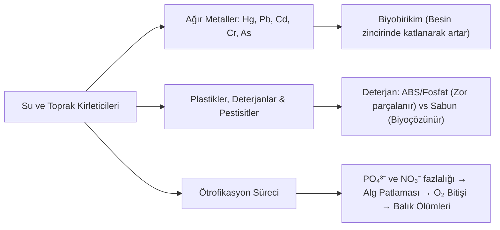
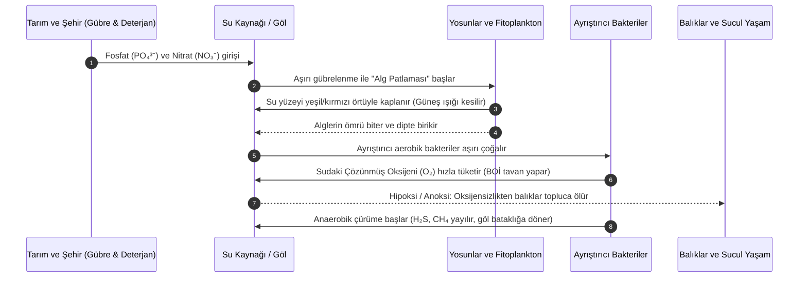
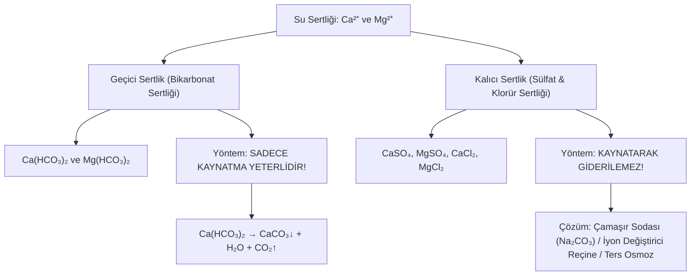

# TYT Kimya: Çevre Kimyası, Hava/Su/Toprak Kirleticileri, Sera Gazları ve Su Arıtımı
## Kapsamlı Araştırma Raporu, Müfredat Analizi ve Oyunlaştırma Veri Yapısı

---

## 1. Giriş ve Müfredat Çerçevesi

Bu doküman, MEB Ortaöğretim Kimya Dersi Öğretim Programı (9. Sınıf 5. Ünite: "Doğa ve Kimya", 10. Sınıf 3. Ünite: "Asitler, Bazlar ve Tuzlar" ile 10. Sınıf 4. Ünite: "Kimya Her Yerde") ve ÖSYM YKS (TYT ve MSÜ) sınav standartlarına göre hazırlanmıştır.

### 1.1. MEB Kazanım Eşleştirmesi
- **9.5.1. Su ve Hayat:**
  - 9.5.1.1. Suyun varlıklar ve çevre için önemini açıklar.
  - 9.5.1.2. Su kaynaklarının korunması ve su tasarrufuna yönelik farkındalık geliştirir.
  - 9.5.1.3. Doğal sulardaki sertlik ve yumuşaklık kavramlarını analiz eder; sert suların evsel ve endüstriyel etkilerini, sertlik giderme yöntemlerini açıklar.
- **9.5.2. Çevre Kimyası:**
  - 9.5.2.1. Hava, su ve toprak kirliliğinin sebeplerini ve çevreye zararlarını kimyasal temellerle açıklar.
  - 9.5.2.2. Sera gazları, küresel ısınma, ozon tabakasının incelmesi ve asit yağmurlarını oluşturan gazları ve reaksiyonlarını belirtir.
  - 9.5.2.3. Ağır metaller, plastikler, deterjanlar ve tarım ilaçlarının su ve toprak kirliliğindeki rolünü, ötrofikasyon mekanizmasını açıklar.
- **10.3.3. Asitler ve Bazların Fayda ve Zararları:**
  - Asit yağmurlarının tarihi eserler, mermer ($CaCO_3$), metaller ve biyolojik yaşam üzerindeki aşındırıcı etkilerini açıklar.
- **10.4.1. Temizlik Maddeleri:**
  - Sabun ve deterjanların çevreye etkilerini, deterjanlardaki fosfatların ötrofikasyona yol açışını karşılaştırır.

### 1.2. ÖSYM Sınav Trendi Analizi
- **Soru Frekansı:** TYT ve MSÜ sınavlarında ortalama 2 yılda bir doğrudan 1 soru bu üniteden gelmektedir.
- **Soru Tipleri:**
  1. *Gaz Eşleştirme / Ayırt Etme:* Verilen gazlardan hangisinin asit yağmuruna, hangisinin sera etkisine, hangisinin ozon tabakasına zarar verdiğini sorgulayan sorular.
  2. *Nötr Oksit Tuzağı:* $CO$, $NO$, $N_2O$ gibi nötr oksitlerin asit yağmuru yapmayacağının bilinip bilinmediğini ölçen sorular (En yaygın çeldirici $CO$'dur).
  3. *Sert Su Özellikleri:* Sert suların sabunu çöktürmesi, kireç tortusu yapması, kaynatılarak geçici sertliğin giderilmesi; ancak sağlık açısından zararlı olmayıp mineral kaynağı olduğunun ayırt edilmesi.
  4. *Ötrofikasyon ve Ağır Metaller:* Biyoakümülasyon (biyobirikim) ve göllerde alg patlaması sonucu oksijen tükenmesi süreci.

---

## 2. Hava Kirleticileri ve Atmosferik Olaylar

Atmosfer kimyasında hava kirleticileri gazlar, partikül maddeler (PM10, PM2.5) ve aerosoller olarak sınıflandırılır. MEB müfredatı temel olarak 4 atmosferik felakete ve bunlara yol açan kimyasal türlere odaklanır.

```mermaid
flowchart TD
    Atm[Hava Kirleticileri ve Gazlar]
    
    Atm --> Sera[Sera Gazları & Küresel Isınma]
    Atm --> Asit[Asit Yağmuru Gazları]
    Atm --> Ozon[Ozon Tabakasını İnceltenler]
    Atm --> Zehir[Zehirli Boğucu Gazlar]

    Sera --> CO2["CO₂ (Karbondioksit - İnsan Kaynaklı #1)"]
    Sera --> CH4["CH₄ (Metan - Yüksek GWP)"]
    Sera --> N2O["N₂O (Diazot monoksit)"]
    Sera --> H2O["H₂O Buharı (Doğal Sera Etkisinde #1)"]
    Sera --> O3_trop["O₃ (Troposferik / Yere Yakın Ozon)"]
    Sera --> CFC_sera["CFC (Kloroflorokarbonlar)"]

    Asit --> SO2["SO₂ (Kükürt dioksit) → H₂SO₄"]
    Asit --> SO3["SO₃ (Kükürt trioksit) → H₂SO₄"]
    Asit --> NO2["NO₂ (Azot dioksit) → HNO₃"]
    Asit -.-> NOT_ASIT["⚠️ TUZAK: CO nötrdür, asit yağmuru yapmaz! CO₂ asıl sebep değildir."]

    Ozon --> CFC["CFC'ler (Freonlar: Soğutucu & Deodorant)"]
    Ozon --> Halon["Halonlar (Yangın Söndürücüler - Br içerir)"]
    Ozon --> CCl4["CCl₄ & Metil Kloroform"]

    Zehir --> CO["CO (Karbonmonoksit) - Sessiz Ölüm / Hemoglobin"]
```



### 2.1. Sera Gazları, Sera Etkisi ve Küresel Isınma

Güneş'ten gelen kısa dalga boylu ışınlar (görünür ışık ve UV) atmosferi geçerek yeryüzünü ısıtır. Isınan yeryüzü enerjiyi uzun dalga boylu **kızılötesi (IR / enfraruj)** ışıma olarak uzaya geri yayar. Atmosferdeki bazı gazlar bu kızılötesi ışınları soğurarak (absorbe ederek) atmosferin ısınmasına yol açar; bu doğal fenomene **Sera Etkisi (Greenhouse Effect)** denir. İnsan faaliyetleri sonucu bu gazların konsantrasyonunun aşırı artması **Küresel Isınma** ve **İklim Değişikliği**ne yol açar.

#### Başlıca Sera Gazları ve Özellikleri:
| Gaz Formülü | Adı | Başlıca Kaynakları | Küresel Isınma Potansiyeli (GWP - 100 yıl) | MEB / ÖSYM Kritik Ayrıntısı |
|---|---|---|---|---|
| **$CO_2$** | Karbondioksit | Fosil yakıtların (kömür, petrol, doğalgaz) yanması, sanayi, ormansızlaşma, çimento üretimi | 1 (Referans) | İnsan kaynaklı sera etkisine en yüksek kümülatif katkıyı yapan gazdır (%70-75). |
| **$CH_4$** | Metan | Pirinç tarlaları (çeltik), geviş getiren hayvanlar, bataklıklar, çöp depolama alanları, doğalgaz kaçakları | ~28 – 36 kat ($CO_2$'ye göre) | $CO_2$'den katbekat güçlü ısı tutma kapasitesine sahiptir. |
| **$N_2O$** | Diazot monoksit ("Güldürücü Gaz") | Aşırı azotlu gübre kullanımı, fosil yakıtlar, naylon/adピk asit endüstrisi, biyokütle yanması | ~265 – 298 kat | Hem güçlü bir sera gazıdır hem de stratosfere ulaştığında ozon parçalanmasına katkıda bulunabilir. |
| **$H_2O$ (buhar)** | Su Buharı | Okyanus ve göllerden doğal buharlaşma, hidrolojik döngü | Değişken (Geri besleme faktörü) | **ÖNEMLİ:** Atmosferdeki *doğal* sera etkisinin yaklaşık %60'ından sorumludur. İnsan doğrudan artıramaz; sıcaklık arttıkça buharlaşma artar (pozitif geri besleme). |
| **$O_3$ (troposferik)**| Troposferik Ozon ("Kötü Ozon") | Fosil yakıt emisyonları ($NO_x$ ve VOC) güneş ışığında fotokimyasal tepkimeye girerek oluşur | ~1000 kat | Stratosferdeki ozon koruyucudur; fakat yer seviyesindeki troposferik ozon sera gazı, toksik kirletici ve fotokimyasal sis bileşenidir. |
| **CFC** | Kloroflorokarbonlar (Freon-11, 12) | Buzdolapları, klimalar, sprey itici gazlar, yalıtım köpükleri | 4.000 – 11.000 kat | Tamamen insan yapımıdır. Hem aşırı güçlü sera gazıdır hem de ozon tabakasını katalitik olarak yok eder. |

---

### 2.2. Asit Yağmurları ve Asidik Ametal Oksitler

Normal yağmur suyu, havadaki $CO_2$ gazının çözünmesiyle oluşan zayıf karbonik asit ($H_2CO_3$) nedeniyle hafif asidiktir ($pH \approx 5.6$). Yağmur suyunun pH değerinin **5.0'ın (genellikle 4.0 - 4.5 seviyelerine)** altına düşmesine **Asit Yağmuru** denir.

#### Asit Yağmuru Oluşturan Gazlar ve Kimyasal Tepkimeler:
1. **Kükürt Oksitler ($SO_2, SO_3 \rightarrow SO_x$):**
   - Kömür ve petrol gibi kükürt ($S$) içeren fosil yakıtların yanması ve volkanik patlamalar sonucu oluşur:
     $$S(k) + O_2(g) \rightarrow SO_2(g)$$
   - Havadaki fotokimyasal oksidasyonla kükürt trioksite dönüşür:
     $$2SO_2(g) + O_2(g) \rightarrow 2SO_3(g)$$
   - Bulutlardaki su buharı ile birleşerek kuvvetli **Sülfürik Asit ($H_2SO_4$)** oluşturur:
     $$SO_3(g) + H_2O(s) \rightarrow H_2SO_4(suda)$$
     *(Veya $SO_2 + H_2O \rightarrow H_2SO_3$ kükürtlü asit)*
2. **Azot Oksitler ($NO_2, NO_x$):**
   - Motorlu taşıtların silindirlerinde ve termik santrallerde çok yüksek sıcaklıkta havadaki $N_2$ ile $O_2$ birleşir:
     $$N_2(g) + O_2(g) \xrightarrow{\text{yüksek } T} 2NO(g)$$
   - Egzozdan çıkan $NO$ havada hızla azot dioksite oksitlenir:
     $$2NO(g) + O_2(g) \rightarrow 2NO_2(g)$$
   - $NO_2$ su buharı ile tepkimeye girerek **Nitrik Asit ($HNO_3$)** ve nitröz asit ($HNO_2$) oluşturur:
     $$2NO_2(g) + H_2O(s) \rightarrow HNO_3(suda) + HNO_2(suda)$$
     $$3NO_2(g) + H_2O(s) \rightarrow 2HNO_3(suda) + NO(g)$$

#### Asit Yağmurlarının Yıkıcı Etkileri:
1. **Tarihi Eserler ve Mermer Yapılar:** Mermer, traverten ve kireç taşı kalsiyum karbonat ($CaCO_3$) içerir. Asit yağmuru kalsiyum karbonatı çözer:
   $$CaCO_3(k) + H_2SO_4(suda) \rightarrow CaSO_4(k) + H_2O(s) + CO_2(g)$$
   Tarihi heykeller, sütunlar ve binalar aşınarak ufalanır.
2. **Toprak ve Bitki Örtüsü:** Toprağın pH'ını düşürür; kalsiyum, magnezyum ve potasyum gibi faydalı katyonları yıkayarak alt katmanlara kaçırır. Toprakta bağlı duran toksik alüminyum ($Al^{3+}$) iyonlarını serbest hale getirerek ağaç köklerini zehirler; ağaçların yaprak kütikulasını eriterek ormanları kurutur.
3. **Sucul Ekosistem:** Göllerde ve nehirlerde pH 5'in altına düştüğünde balık yumurtaları gelişemez, balıkların solungaçlarında alüminyum çökerek boğulmalarına yol açar ("ölü göller").
4. **Metal Korozyonu:** Metal köprüler, tren rayları, araç kaportaları hızla paslanır ve aşınır ($Fe + 2H^+ \rightarrow Fe^{2+} + H_2$).

#### 🚨 ÖSYM Tuzakları ve Kritik Noktalar:
> [!CAUTION]
> **NÖTR OKSİT TUZAĞI ($CO, NO, N_2O$):**
> Ametallerin oksijence zengin olmayan oksitleri (oksijen sayısı ametal sayısına eşit veya küçük olanlar) **NÖTR OKSİTTİR**.
> - $CO$ (Karbonmonoksit) **NÖTRDÜR**, suyla tepkime vermez, asit oluşturmaz, **ASİT YAĞMURU YAPMAZ!** (Sınavlarda en sık sorulan çeldiricidir).
> - $NO$ ve $N_2O$ nötr oksittir, suyla tepkime vermezler (ancak $NO$ atmosferde $NO_2$'ye yükseltgenirse asit yağmuruna dönüşebilir).
> - $CO_2$ asidik oksittir fakat zayıf asit oluşturduğu için doğal yağmurun pH'ını ~5.6 yapar. Asit yağmuru felaketinin (pH < 4.5) sebebi $CO_2$ DEĞİL, **$SO_2, SO_3$ ve $NO_2$** gazlarıdır.

---

### 2.3. Ozon Tabakası ve İncelmesine Yol Açan Kimyasallar

Stratosfer tabakasında (yerden yaklaşık 15–35 km yükseklikte) bulunan ozon tabakası ($O_3$), Güneş'ten gelen yüksek enerjili ve kanserojen **UV-B ve UV-C (morötesi)** ışınlarını soğurarak Dünya'daki canlı yaşamını korur.

#### Ozon Tabakasını İncelten Maddeler (ODS - Ozone Depleting Substances):
1. **Kloroflorokarbonlar (CFC'ler - Freonlar):**
   - Parfüm, deodorant ve spreylerde itici gaz, buzdolabı ve klimalarda soğutucu akışkan, köpük ve yangın söndürücülerde kullanılmıştır.
2. **Halonlar (Bromoflorokarbonlar):**
   - Özellikle yangın söndürme sistemlerinde kullanılır. Yapılarındaki **Brom ($Br$)** atomu, ozon parçalamada klordan 40-100 kat daha etkilidir!
3. **Karbon Tetraklorür ($CCl_4$) ve Metil Kloroform ($CH_3CCl_3$):**
   - Sanayide yağ çözücü ve kimyasal çözücü olarak kullanılan klorlu hidrokarbonlar.
4. **Metil Bromür ($CH_3Br$):**
   - Tarımda toprak sterilizasyonunda kullanılan fümigant / pestisit.

#### Ozon Parçalanma Mekanizması:
CFC molekülleri troposferde bozulmadan stratosfere yükselir. Burada yüksek enerjili UV fotonları karbon-klor bağını kırarak son derece reaktif **Klor serbest radikali ($Cl^\bullet$)** açığa çıkarır:
$$CF_2Cl_2 + h\nu(UV) \rightarrow CF_2Cl^\bullet + Cl^\bullet$$
Açığa çıkan klor radikali katalitik bir döngü başlatır:
1. $Cl^\bullet + O_3 \rightarrow ClO^\bullet + O_2$
2. $ClO^\bullet + O \rightarrow Cl^\bullet + O_2$
3. Net Reaksiyon: $O_3 + O \rightarrow 2O_2$

> [!IMPORTANT]
> **Katalitik Etki:** Serbest klor radikali ($Cl^\bullet$) reaksiyondan harcanmadan geri çıkar. Bu nedenle **tek bir klor atomu yaklaşık 100.000 ozon ($O_3$) molekülünü parçalayabilir!**
> 1987 yılında imzalanan **Montreal Protokolü** ile CFC gazlarının üretimi ve kullanımı küresel çapta sınırlandırılmış ve yasaklanmıştır.

---

### 2.4. Karbonmonoksit ($CO$) Gazı ve Zehirlenme Mekanizması

- **Fiziksel Özellikleri:** Renksiz, kokusuz, tatsız, havadan biraz hafif ve tahriş edici olmayan bir gazdır. Bu nedenle hissedilemez ve **"Sessiz Katil (Sessiz Ölüm)"** olarak adlandırılır.
- **Oluşum Kaynağı:** Karbon içeren yakıtların (kömür, odun, doğalgaz, lpg, benzin) **yetersiz oksijenli ortamda eksik / tam olmayan yanması (eksik yanma):**
  $$C + \frac{1}{2} O_2 \rightarrow CO \quad (\text{Yetersiz } O_2)$$
  *(Yeterli oksijende $C + O_2 \rightarrow CO_2$ oluşur).*
  Kış aylarında rüzgarlı havalarda soba geri tepmesi, tıkalı bacalar, şofben kaçakları, kapalı otoparklarda çalışan araba motorları en yaygın zehirlenme kaynaklarıdır.
- **Zehirlenme Mekanizması (Biyokimyasal Temel):**
  - Kırmızı kan hücrelerindeki hemoglobin ($Hb$) proteini normalde dokulara $O_2$ taşır (oksihemoglobin).
  - Karbonmonoksitin hemoglobine bağlanma ilgisi (afinitesi), oksijenden yaklaşık **200 – 250 kat daha fazladır**.
  - $CO$, hemoglobine geri dönüşümsüz veya çok zor ayrışacak şekilde bağlanarak **Karboksihemoglobin ($COHb$)** kompleksini oluşturur:
    $$Hb + CO \rightarrow COHb$$
  - Hemoglobin oksijen taşıyamaz hale gelir. Hücresel düzeyde oksijen yetersizliği (hipoksi/asfiksi), bilinç kaybı, beyin ölümü ve kısa sürede ölüm meydana gelir.

---

## 3. Su ve Toprak Kirleticileri

Su ve toprak kirliliği çoğunlukla birbiriyle doğrudan bağlantılıdır; toprağa dökülen veya atılan kimyasallar yağmur suları ve sızma yoluyla yeraltı ve yerüstü su havzalarına ulaşır.



### 3.1. Ağır Metaller ve Toksisiteleri

Yoğunluğu genellikle $5\text{ g/cm}^3$'ten büyük olan metaller ve metaloidler "ağır metal" olarak adlandırılır. Ağır metaller doğada kendiliğinden yok olmaz, biyolojik organizmalarda parçalanamaz ve vücuttan atılımı son derece zordur. Besin zinciri basamaklarında yukarı çıkıldıkça dokulardaki derişimleri katlanarak artar; bu olaya **Biyoakümülasyon (Biyobirikim / Biyolojik Büyütme)** denir.

| Ağır Metal / Element | Sembol | Yoğunluk & Form | Temel Kaynakları | İnsan Sağlığı ve Çevreye Zararları |
|---|---|---|---|---|
| **Cıva** | **Hg** | $13.53\text{ g/cm}^3$ (Oda koşullarında tek sıvı metal) | Floresan lambalar, termometreler, piller, kömürlü termik santraller, amalgam dolgular, boya sanayi | Suda bakterilerce **metilcıva ($CH_3Hg^+$)** bileşiğine dönüştürülür. Balıklarda birikir. Santral sinir sistemini, beyin fonksiyonlarını ve böbrekleri tahrip eder. Tarihi **Minamata Hastalığı**na yol açmıştır. |
| **Kurşun** | **Pb** | $11.34\text{ g/cm}^3$ | Aküler (kurşunlu akü), eski kurşunlu benzinler (tetraetil kurşun), kurşun borular, boyalar, lehim, mühimmat | Çocuklarda zeka geriliği ve öğrenme güçlüğü, sinir sistemi hasarı, kanda hemoglobin sentezini engelleyerek anemi, böbrek yetmezliği. |
| **Kadmiyum** | **Cd** | $8.65\text{ g/cm}^3$ | Nikel-kadmiyum (Ni-Cd) şarjlı piller, metal kaplama, plastik stabilizörleri, fosfatlı gübre safsızlıkları, sigara dumanı | Kemik erimesi ve şiddetli kemik ağrıları/kırılmaları (**Itai-Itai Hastalığı**), böbrek yetmezliği, akciğer hasarı, kanserojen etki. |
| **Krom** | **Cr** | $7.19\text{ g/cm}^3$ | Deri tabaklama (dericilik sanayi), paslanmaz çelik üretimi, metal kaplama ve korozyon önleyiciler | $Cr(III)$ nispeten düşük toksisiteli iken, **Hekzavalent Krom [$Cr(VI)$ / Kromat-Dikromat]** son derece zehirli, DNA kırıcı ve güçlü bir kanserojendir. |
| **Arsenik** | **As** | $5.73\text{ g/cm}^3$ (Metaloid) | Madencilik atıkları, pestisitler (tarım ilaçları), jeotermal sular, ahşap koruyucular | Cilt lezyonları, cilt ve iç organ kanserleri, damar tıkanıklığı, sinir sistemi zehirlenmesi. |

---

### 3.2. Plastikler, Deterjanlar ve Tarım İlaçları (Pestisitler)

#### A. Plastikler:
- Petrol türevi sentetik monomerlerin polimerleşmesiyle elde edilir (Polietilen - PE, Polietilen tereftalat - PET, Polivinil klorür - PVC, Polistiren - PS, Polipropilen - PP).
- **Çevre Sorunu:** Doğada biyolojik olarak parçalanmaları yüzlerce (400-1000) yıl sürer. Güneş ışığı ve mekanik aşınmayla **Mikroplastiklere ($< 5\text{ mm}$)** bölünürler.
- Mikroplastikler sucul canlıların solungaç ve sindirim sistemine dolar, besin zinciriyle sofralarımıza gelir. İçerdikleri plastifiyanlar (Ftalatlar, Bisfenol A - BPA) endokrin (hormon) sistemini bozar.

#### B. Temizlik Maddeleri: Sabun ve Deterjan Kıyaslaması (MEB Önemli Kazanımı):
| Özellik | Sabun | Deterjan |
|---|---|---|
| **Hammadde Kaynağı** | Bitkisel veya hayvansal yağlar (Doğal trigliseritler) + $NaOH$ / $KOH$ | Petrol türevleri (Alkil benzen sülfonatlar - LABS, ABS) |
| **Biyoçözünürlük** | Doğada mikroorganizmalar tarafından kolayca parçalanır. | Doğada çok zor parçalanır (özellikle benzen halkası ve dallanmış alkil zinciri içeren ABS). |
| **Çevreye Etkisi** | **Çevre dostudur**, su ve toprağı kalıcı kirletmez. | **Çevre kirleticisidir**, yer altı ve yer üstü sularında birikir. |
| **Sert Suda Davranışı** | Sert sudaki $Ca^{2+}$ ve $Mg^{2+}$ iyonlarıyla çökelek oluşturur, **köpürmez ve temizleme gücü düşer.** | Sert sudaki $Ca^{2+}$ ve $Mg^{2+}$ iyonlarıyla çökelti oluşturmaz, **sert sularda bile mükemmel köpürür ve temizler.** |
| **Fosfat Katkısı** | İçermez. | Sertlik iyonlarını bağlamak için sodyum tripolifosfat ($STPP$) içerir; **ötrofikasyona** yol açar. |

#### C. Tarım İlaçları (Pestisitler) ve Yapay Gübreler:
- İnsektisit (böcek öldürücü), herbisit (yabani ot öldürücü), fungisit (mantar öldürücü).
- Örnek: DDT (Diklro Difenil Trikloroetan) - Biyobirikim nedeniyle yırtıcı kuşların yumurta kabuklarını incelterek soylarını tehlikeye atmış ve yasaklanmıştır.
- Topraktaki yararlı mikroorganizmaları öldürür, toprağın verimini ve humus dengesini bozar; yağmur sularıyla yeraltı sularına karışır.

---

### 3.3. Ötrofikasyon (Eutrophication / Alg Patlaması)

Göl, gölet, baraj ve yavaş akan akarsularda aşırı besin maddesi birikmesi sonucu ekosistemin çökmesi sürecidir. Kelime anlamı "aşırı beslenme"dir.



#### Ötrofikasyonun Adım Adım Mekanizması:
1. **Besin Tuzu Girişi:** Tarımsal arazilerden aşırı kullanılan azotlu gübrelerin sızmasıyla **Nitrat ($NO_3^-$)**, evsel ve endüstriyel deterjan atıklarıyla **Fosfat ($PO_4^{3-}$)** su kaynaklarına akar. (Fosfat genellikle sınırlayıcı faktördür; fosfat girdisi olayı tetikler).
2. **Alg Patlaması (Yosun Patlaması):** Fosfat ve nitrat bolluğu su yüzeyindeki mikroskobik alglerin ve bitkilerin kontrolsüzce çoğalmasına neden olur.
3. **Işık İletiminin Kesilmesi:** Yüzeyi kaplayan yoğun yeşil yosun tabakası güneş ışığının göl derinliklerine ulaşmasını engeller. Derinlerdeki su bitkileri fotosentez yapamaz ve ölür.
4. **Oksijenin Tükenmesi:** Ölen alg ve bitki biyokütlesini parçalamak için göldeki ayrıştırıcı (saprofit) bakteriler aşırı ürer. Bu bakteriler solunumlarında sudaki **çözünmüş oksijeni ($O_2$)** hızla tüketir; Biyokimyasal Oksijen İhtiyacı (BOİ) yükselir.
5. **Canlı Yaşamının Sonu (Hipoksi/Anoksi):** Oksijen seviyesi sıfıra yaklaştığında balıklar ve diğer solungaçlı canlılar topluca ölür.
6. **Kokuşma ve Bataklıklaşma:** Oksijensiz kalan dip katmanlarda anaerobik fermantasyon başlar. Zehirli ve çürük yumurta kokulu hidrojen sülfür ($H_2S$) ve metan ($CH_4$) gazları çıkar; göl bataklığa dönüşerek yok olur.

---

## 4. Su Arıtımı ve Su Sertliği

### 4.1. Sert Su ve Yumuşak Su Kavramı

İçerisinde çözünmüş **Kalsiyum ($Ca^{2+}$) ve Magnezyum ($Mg^{2+}$)** iyonları derişimi yüksek olan sulara **Sert Su**, bu iyonların derişimi çok düşük olan sulara ise **Yumuşak Su** denir. (Bazen $Fe^{2+}$ ve $Mn^{2+}$ iyonları da sertliğe katkı verir).

#### Sert Suyun Etkileri ve Özellikleri:
- **Sabun Sarfiyatı:** Sabundaki stearat iyonları sert sudaki kalsiyum ve magnezyum ile birleşerek suda çözünmeyen yapışkan bir çökelek (sabun taşı/kireci) oluşturur:
  $$2C_{17}H_{35}COO^-Na^+(suda) + Ca^{2+}(suda) \rightarrow (C_{17}H_{35}COO)_2Ca(k) \downarrow + 2Na^+(suda)$$
  Bu çökelek oluşumu tamamlanana kadar sabun köpürmez; sabun tüketimi ve maliyeti katbekat artar.
- **Kireç Tortusu ve Isı İletimi:** Çaydanlık diplerinde, su ısıtıcılarında (kettle), çamaşır ve bulaşık makinelerinin rezistanslarında, kalorifer ve sanayi buhar kazanlarında kireç taşı ($CaCO_3$) tortusu oluşturur. Kireç tabakası ısı yalıtkanı gibi davranır; rezistansın ısı iletimini engeller, **enerji (elektrik/yakıt) sarfiyatını %10 - %30 artırır**, rezistansların patlamasına ve boruların tıkanmasına yol açar.
- **Tekstil Üzerindeki Etkisi:** Çamaşırların lifleri arasına $CaCO_3$ kristalleri girerek kumaşları grileştirir, sertleştirir ve yıpratır.
- **Sağlık Yönü (ÇOK ÖNEMLİ):**
  > [!NOTE]
  > **ÖSYM TUZAĞI:** Sert sular sanılanın aksine **SAĞLIĞA ZARARLI DEĞİLDİR.** İçerdikleri $Ca^{2+}$ ve $Mg^{2+}$ iyonları kemik ve diş gelişimi, kas ve kalp-damar sağlığı için faydalı mineral kaynağıdır. Sert suların lezzeti kireçli ve acımtıraktır; fakat toksik değildir. Sorun sağlık değil, tesisat ve temizlik ekonomisidir!

---

### 4.2. Geçici Sertlik ve Kalıcı Sertlik

Su sertliği kaynağına ve giderilme yöntemine göre ikiye ayrılır:



#### Karşılaştırma Tablosu:
| Özellik | Geçici Sertlik (Bikarbonat Sertliği) | Kalıcı Sertlik |
|---|---|---|
| **Sorumlu İyonlar** | $Ca^{2+}, Mg^{2+}$ iyonlarının yanında **Bikarbonat ($HCO_3^-$)** iyonu bulunur. | $Ca^{2+}, Mg^{2+}$ iyonlarının yanında **Sülfat ($SO_4^{2-}$)** veya **Klorür ($Cl^-$)** iyonu bulunur. |
| **Tipik Bileşikler** | Kalsiyum bikarbonat: $Ca(HCO_3)_2$<br>Magnezyum bikarbonat: $Mg(HCO_3)_2$ | Kalsiyum sülfat: $CaSO_4$<br>Magnezyum sülfat: $MgSO_4$<br>Kalsiyum klorür: $CaCl_2$<br>Magnezyum klorür: $MgCl_2$ |
| **Kaynatma ile Giderilebilir mi?** | **EVET, tamamen giderilir.** | **HAYIR, sadece kaynatarak giderilemez!** |
| **Giderme Reaksiyonu / Yöntemi** | **Isıtma / Kaynatma:**<br>$$Ca(HCO_3)_2(suda) \xrightarrow{\Delta} CaCO_3(k) \downarrow + H_2O(s) + CO_2(g) \uparrow$$<br>Çözünmeyen kalsiyum karbonat ($CaCO_3$) dibe çöker ve süzülerek sudan ayrılır. | 1. **Kimyasal Çöktürme (Çamaşır Sodası - $Na_2CO_3$ ilavesi):**<br>$$CaSO_4(suda) + Na_2CO_3(suda) \rightarrow CaCO_3(k) \downarrow + Na_2SO_4(suda)$$<br>2. **İyon Değiştirici Reçine Yöntemi**<br>3. **Ters Osmoz (Reverse Osmosis)** |

#### Sertlik Giderme Teknolojileri:
1. **İyon Değiştirici Reçineler (Zeolitler):**
   - Sentetik polimerik reçineler bünyelerinde sodyum ($Na^+$) veya hidrojen ($H^+$) iyonları taşır.
   - Sert su reçineden geçerken, reçine $Ca^{2+}$ ve $Mg^{2+}$ iyonlarını yakalar ve suya zararsız $Na^+$ iyonlarını bırakır:
     $$2R-Na + Ca^{2+}(suda) \rightleftharpoons R_2-Ca + 2Na^+(suda)$$
   - Reçine dolduğunda derişik sofra tuzu ($NaCl$) çözeltisiyle yıkanarak rejenere edilir (tazelenir).
2. **Ters Osmoz (Reverse Osmosis - RO):**
   - Doğal osmotik basıncın üzerinde yüksek mekanik basınç uygulanarak, su moleküllerinin yarı geçirgen (semi-permeable) zardan geçmeye zorlanması; tüm iyonların, ağır metallerin ve tuzların zarda tutulması işlemidir.

---

### 4.3. Şehir Şebeke Suyu Arıtımının Aşamaları

Doğal kaynaklardan (baraj, göl, nehir) alınan ham suyun içme ve kullanma standartlarına ulaştırılması için uygulanan birbirini takip eden endüstriyel prosesler:


1. **Havalandırma (Aerasyon):**
   - Su fıskiyelerle havaya püskürtülür veya dipten hava kabarcıkları verilir.
   - Amacı: Suya çözünmüş oksijen ($O_2$) kazandırmak; sudaki kötü kokulu ve uçucu gazları ($H_2S, CO_2$, metan) uzaklaştırmak; çözünmüş $Fe^{2+}$ ve $Mn^{2+}$ iyonlarını oksitleyerek çözünmeyen pas çökeltilerine ($Fe(OH)_3, MnO_2$) dönüştürmek.
2. **Koagülasyon (Pıhtılaştırma):**
   - Su içinde asılı kalan çok küçük kolloidal tanecikler negatif yüklüdür ve birbirini ittikleri için yerçekimiyle çökmezler.
   - Suya **Şap [$Al_2(SO_4)_3$ veya $KAl(SO_4)_2 \cdot 12H_2O$]** veya demir(III) klorür ($FeCl_3$) gibi koagülant kimyasallar eklenir. Bu tuzlar kolloitlerin yüzey yükünü nötralize eder.
3. **Flokülasyon (Yumaklaştırma):**
   - Su yavaşça karıştırılarak nötralize olan mikroskobik taneciklerin birbiriyle çarpışıp birleşmesi ve gözle görülür ağır yumaklar (floklar) oluşturması sağlanır.
4. **Sedimantasyon (Çökeltme):**
   - Su geniş dinlendirme havuzlarına alınır; ağırlaşan floklar yerçekimi etkisiyle havuz tabanına çöker ve çamur olarak dipten uzaklaştırılır.
5. **Filtrasyon (Süzme):**
   - Çökeltme havuzundan çıkan berraklaşmış su; farklı tane boyutlarına sahip kuvars kumu, antrasit ve çakıl yataklarından geçirilerek kalan mikro süspansiyonlar tutulur.
6. **Dezenfeksiyon (Mikroorganizma İmhası):**
   - Suda bulunabilecek patojen bakteri, virüs ve parazitlerin öldürülmesi işlemidir.
   - **Klorlama:** En yaygın yöntemdir ($Cl_2$ gazı, sodyum hipoklorit $NaClO$ çamaşır suyu, kalsiyum hipoklorit). Klor su ile tepkimeye girerek kuvvetli dezenfektan olan hipokloröz asit ($HClO$) oluşturur:
     $$Cl_2 + H_2O \rightleftharpoons HClO + HCl$$
     *Klorlamanın en büyük avantajı kalıntı klor bırakarak boru hattı boyunca musluğa kadar dezenfeksiyonu sürdürmesidir.*
   - **Ozonlama ($O_3$):** Çok güçlü oksitleyicidir, mikropları anında öldürür ve klor gibi koku bırakmaz; fakat boru hattında koruyucu kalıcılığı yoktur.
   - **UV (Ultraviyole Işınlama):** Kimyasal madde eklemeden mikroorganizmaların DNA'sını bozar; kalıntı etkisi yoktur.
7. **Adsorpsiyon (Aktif Karbon Filtreleme):**
   - Geniş iç yüzey alanına sahip aktif karbon granülleri kullanılarak sudaki pestisit kalıntıları, organik kirleticiler, istenmeyen tat, koku ve klor kalıntıları tutulur.

---

## 5. Oyunlaştırma (Gamification) & Veri Yapısı Mimarisi

Bu konunun kimya bilgi yarışması uygulamasına entegrasyonu için TypeScript veri modelleri ve akıllı çeldirici stratejileri aşağıda modellenmiştir.

### 5.1. TypeScript Tip Tanımları (`src/types/environmental.ts`)

```typescript
export type EnvironmentalCategory = 
  | 'greenhouse_gas'        // Sera Gazları & Küresel Isınma
  | 'acid_rain'             // Asit Yağmuru Gazları ve Nötr Oksitler
  | 'ozone_depletion'       // Ozon Tabakası Kirleticileri
  | 'toxic_gas'             // Karbonmonoksit ve Zehirli Gazlar
  | 'heavy_metal'           // Ağır Metaller ve Biyoakümülasyon
  | 'organic_pollutant'     // Plastikler, Deterjanlar, Pestisitler
  | 'eutrophication'        // Ötrofikasyon Mekanizması
  | 'water_hardness'        // Su Sertliği (Geçici/Kalıcı)
  | 'water_treatment';      // Su Arıtım Basamakları

export interface EnvironmentalItem {
  id: string;                       // Benzersiz kimlik: örn. 'ENV_CO2', 'ENV_ACID_SO2'
  category: EnvironmentalCategory;  // Ana kategori
  title: string;                    // Madde / Kavram adı: örn. 'Kükürt Dioksit (SO₂)'
  formulaOrSymbol?: string;         // Kimyasal formül veya sembol: örn. 'SO₂', 'Hg', 'Ca(HCO₃)₂'
  roleOrDanger: string;             // Temel rolü veya oluşturduğu tehlike
  sourceOrOrigin: string;           // Kaynağı veya oluşum mekanizması
  isTrap?: boolean;                 // Sınavda yaygın çeldirici/tuzak mı?
  trapExplanation?: string;         // Tuzak açıklaması (neden çeldirici olduğu)
  solutionOrRemedy?: string;        // Çözüm / Giderme yöntemi
  synonyms?: string[];              // Eş anlamlı / alternatif yazımlar
  tags: string[];                   // Filtreleme etiketleri
}
```

### 5.2. Quiz Motoru İçin Soru Mekanikleri (Direction Modelleri)

Kullanıcıya tekdüze sorular sormak yerine, konunun ruhuna uygun 5 farklı oyun mekaniği kurgulanabilir:

1. **Yönelim 1: Etki Eşleştirme (Gaz $\rightarrow$ Çevre Sorunu):**
   - *Soru:* "$SO_2$ ve $NO_2$ gazları atmosferde su buharıyla birleştiğinde öncelikli olarak hangi çevre felaketine yol açar?"
   - *Doğru:* Asit Yağmurları
   - *Çeldiriciler:* Ozon Tabakasının İncelmesi, Ötrofikasyon, Su Sertliği
2. **Yönelim 2: Asit Yağmuru Dedektörü (Nötr Oksit Tuzağı):**
   - *Soru:* "Aşağıdaki gazlardan hangisi asit yağmurlarının oluşumuna neden **olmaz**?"
   - *Doğru:* $CO$ (Karbonmonoksit)
   - *Çeldiriciler:* $SO_2$, $SO_3$, $NO_2$
   - *Açıklama:* $CO$ nötr oksittir, suyla asit oluşturmaz.
3. **Yönelim 3: Sertlik Sınıflandırma ve Giderme (Geçici vs. Kalıcı):**
   - *Soru:* "$Ca(HCO_3)_2$ içeren bir suyun sertliği hangi türdedir ve bu sertlik yalnızca kaynatma ile giderilebilir mi?"
   - *Doğru:* Geçici Sertlik — Evet, kaynatılarak çöktürülür.
   - *Çeldiriciler:* Kalıcı Sertlik — Hayır, Kalıcı Sertlik — Evet, Geçici Sertlik — Hayır sadece reçineyle.
4. **Yönelim 4: Ağır Metal Dedektifi:**
   - *Soru:* "Oda koşullarında sıvı halde bulunan, balıklarda metil türevi birikerek Minamata hastalığına ve sinir hasarına yol açan ağır metal hangisidir?"
   - *Doğru:* Cıva ($Hg$)
   - *Çeldiriciler:* Kurşun ($Pb$), Kadmiyum ($Cd$), Krom ($Cr$)
5. **Yönelim 5: Ötrofikasyon ve Su Kimyası:**
   - *Soru:* "Deterjan atıkları ve suni gübrelerle sulara aşırı karışarak göllerde alg patlamasına ve oksijenin tükenmesine (ötrofikasyon) neden olan birincil iyon çifti hangisidir?"
   - *Doğru:* Fosfat ($PO_4^{3-}$) ve Nitrat ($NO_3^-$)
   - *Çeldiriciler:* Sodyum ($Na^+$) ve Klorür ($Cl^-$), Kalsiyum ($Ca^{2+}$) ve Magnezyum ($Mg^{2+}$), Sülfat ($SO_4^{2-}$) ve Karbonat ($CO_3^{2-}$)

---

## 6. Kapsamlı Veri Seti (StandardQuizItem Formatında Hazır Veri)

Aşağıdaki liste, doğrudan `StandardQuizItem` formatına dönüştürülebilecek 35 maddelik eksiksiz TYT Çevre Kimyası ve Su Arıtımı veri havuzunu içerir:

| ID | Başlık / Formül | Kategori | Doğru Cevap / Tanım | Akıllı Çeldiriciler | MEB Bilgi Notu & İpucu (Hint) |
|---|---|---|---|---|---|
| `ENV_01` | **Karbondioksit ($CO_2$)** | Sera Gazı | Fosil yakıtların yanmasıyla oluşan ve küresel ısınmaya insan eliyle en büyük katkıyı yapan sera gazı | $CO$, $SO_2$, $N_2$ | Fosil yakıt yanması ürünüdür; asit yağmurunun birincil sebebi değildir! |
| `ENV_02` | **Metan ($CH_4$)** | Sera Gazı | Çeltik tarlaları, geviş getiren hayvanlar ve çöplüklerden salınan, $CO_2$'den kat kat güçlü sera gazı | $C_2H_6$, $CO_2$, $H_2S$ | Doğalgazın ana bileşenidir; sera gazı etkisi $CO_2$'den 28-36 kat fazladır. |
| `ENV_03` | **Su Buharı ($H_2O$)** | Sera Gazı | Atmosferdeki doğal sera etkisinin yaklaşık %60'ından sorumlu olan en baskın doğal sera gazı | $CO_2$, $N_2$, $O_2$ | Doğal sera etkisinde payı en yüksektir ancak döngüseldir. |
| `ENV_04` | **Diazot Monoksit ($N_2O$)** | Sera Gazı | Aşırı azotlu gübre kullanımı ve sanayi sonucu salınan, güldürücü gaz olarak da bilinen güçlü sera gazı | $NO_2$, $NO$, $N_2$ | Küresel ısınma potansiyeli $CO_2$'nin yaklaşık 300 katıdır. |
| `ENV_05` | **Kloroflorokarbon (CFC)** | Sera & Ozon | Hem güçlü bir sera gazı olan hem de stratosferdeki ozon tabakasını katalitik parçalayan yapay gaz | $CH_4$, $CO_2$, $SO_2$ | Klimalar, buzdolapları ve deodorant itici gazlarında kullanılmıştır. |
| `ENV_06` | **Kükürt Dioksit ($SO_2$)** | Asit Yağmuru | Kömür ve petrolün yanmasıyla oluşan, suyla birleşerek sülfürik asit oluşturan birincil asit yağmuru gazı | $CO$, $CO_2$, $CH_4$ | Fosil yakıtlardaki kükürt ($S$) safsızlıklarından kaynaklanır. |
| `ENV_07` | **Kükürt Trioksit ($SO_3$)** | Asit Yağmuru | $SO_2$'nin havadaki oksidasyonuyla oluşan, suyla doğrudan kuvvetli sülfürik asit ($H_2SO_4$) veren gaz | $SO_2$, $CO$, $NO$ | $SO_3 + H_2O \rightarrow H_2SO_4$ tepkimesiyle asit yağmuru yapar. |
| `ENV_08` | **Azot Dioksit ($NO_2$)** | Asit Yağmuru | Araç egzozlarından yüksek sıcaklıkta çıkan, suyla tepkimesinde nitrik asit ($HNO_3$) oluşturan kahverengi gaz | $N_2O$, $CO$, $CH_4$ | Havada su buharıyla $HNO_3$ (kezzap) oluşturur. |
| `ENV_09` | **Karbonmonoksit ($CO$)** | Zehirli / Nötr | Nötr oksit olduğu için asit yağmuru yapmayan; kana bağlanarak sessiz ölüme yol açan zehirli gaz | $CO_2$, $SO_2$, $NO_2$ | **ÖSYM TUZAĞI:** $CO$ nötrdür, asit yağmuru YAPMAZ! |
| `ENV_10` | **Azot Monoksit ($NO$)** | Nötr Oksit | Egzozdan ilk çıkan, nötr oksit olduğu için doğrudan suyla asit oluşturmayan ametal oksit | $NO_2$, $SO_3$, $CO_2$ | Havadaki $O_2$ ile $NO_2$'ye dönüşmeden önce suyla asit vermez. |
| `ENV_11` | **Halon Gazları** | Ozon Kirleticisi | Yangın söndürücülerde kullanılan, içindeki brom ($Br$) atomlarıyla ozonu klordan çok daha hızlı yok eden gazlar | Freon-12, $CO_2$, $N_2$ | Brom atomları ozon parçalamada klordan 40-100 kat daha etkindir. |
| `ENV_12` | **Troposferik Ozon ($O_3$)** | Fotokimyasal Sis | Yeryüzüne yakın tabakada egzoz gazlarının güneş ışığıyla tepkimesinden doğan zararlı sera gazı ve kirletici | Stratosferik Ozon, $CO_2$, $O_2$ | Stratosferdeki ozon koruyucu iken, yer seviyesindeki ozon toksik kirleticidir. |
| `ENV_13` | **Cıva ($Hg$)** | Ağır Metal | Sıvı metal olan, balıklarda metilcıva olarak biriken ve Minamata sinir hastalığına yol açan ağır metal | Kurşun, Kadmiyum, Arsenik | Floresan lamba ve pillerde bulunur; biyolojik birikimi çok yüksektir. |
| `ENV_14` | **Kurşun ($Pb$)** | Ağır Metal | Akülerde ve eski benzinlerde bulunan, çocuklarda zeka geriliği ve kanda anemiye yol açan ağır metal | Cıva, Krom, Kadmiyum | Sinir sistemi ve hemoglobin sentezine doğrudan zarar verir. |
| `ENV_15` | **Kadmiyum ($Cd$)** | Ağır Metal | Ni-Cd piller ve sigarada bulunan, Itai-Itai kemik erimesi hastalığına ve böbrek hasarına yol açan ağır metal | Kurşun, Cıva, Arsenik | Kemiklerde kalsiyumun yerini alarak kırılganlık yapar. |
| `ENV_16` | **Krom-6 [$Cr(VI)$]** | Ağır Metal | Deri tabaklama ve metal kaplamada kullanılan, DNA hasarı ve kansere yol açan yüksek toksisiteli ağır metal | $Cr(III)$, Demir, Çinko | Hekzavalent krom karsinojendir; $Cr(III)$ daha zararsızdır. |
| `ENV_17` | **Arsenik ($As$)** | Ağır Metaloid | Yeraltı sularına ve maden atıklarına karışan, deride lezyonlara ve kansere yol açan zehirli yarı metal | Cıva, Kurşun, Kadmiyum | Tarım ilaçlarında ve jeotermal sularda rastlanabilir. |
| `ENV_18` | **Biyoakümülasyon** | Çevre Ekolojisi | Ağır metal ve pestisitlerin parçalanamayarak besin zincirinin üst basamaklarında katlanarak birikmesi olayı | Ötrofikasyon, Sedimantasyon, Asifikasyon | Piramidin en üstündeki yırtıcı ve insanda derişim en yüksektir. |
| `ENV_19` | **Fosfat İyonu ($PO_4^{3-}$)**| Ötrofikasyon | Deterjanlardaki yumuşatıcı katkılardan ve gübrelerden sulara karışarak alg patlamasını tetikleyen ana iyon | $Cl^-$, $SO_4^{2-}$, $Na^+$ | Göllerde alg patlamasının genellikle birincil tetikleyicisidir. |
| `ENV_20` | **Nitrat İyonu ($NO_3^-$)** | Ötrofikasyon | Aşırı tarımsal gübreleme sonucu yeraltı ve yerüstü sularına karışarak ötrofikasyona yol açan azot tuzu | $CO_3^{2-}$, $PO_4^{3-}$, $Cl^-$ | Bitkiler için gübredir fakat suda alglerin aşırı üremesine yol açar. |
| `ENV_21` | **Ötrofikasyon** | Çevre Olayı | Fosfat ve nitrat fazlalığıyla su yüzeyini alglerin kaplaması, oksijenin bitmesi ve balık ölümleri süreci | Biyoakümülasyon, Asit Yağmuru, Sera Etkisi | "Aşırı beslenme" anlamına gelir; gölü oksijensiz bataklığa çevirir. |
| `ENV_22` | **Biyokimyasal Oksijen İhtiyacı (BOİ)** | Su Kirliliği | Sudaki organik kirleticileri parçalamak için ayrıştırıcı bakterilerin tükettiği çözünmüş $O_2$ miktarı | Kimyasal Sertlik, pH Değeri, İletkenlik | BOİ değeri ne kadar yüksekse sudaki organik kirlilik o kadar fazladır. |
| `ENV_23` | **Mikroplastik** | Toprak/Su Kirletici| Boyutu 5 milimetreden küçük olan, doğada yüzlerce yıl parçalanmayan ve besin zincirine giren polimer parçacıkları | Kolloit, Flok, Koagülant | Plastiklerin güneş ve mekanik aşınmayla ufalanmasından doğar. |
| `ENV_24` | **Deterjan (ABS / LABS)** | Kirletici | Petrol kökenli olan, doğada zor parçalanan, sert sularda bile köpüren çevre kirleticisi temizlik maddesi | Sabun, Şap, Kireç | Sabun doğal yağdan üretilir ve çevre dostudur; deterjan petrolden üretilir. |
| `ENV_25` | **Sabun** | Çevre Dostu | Bitkisel ve hayvansal yağlardan üretilen, doğada kolay parçalanan fakat sert suda çökelerek köpürmeyen temizlik maddesi | Deterjan, Çamaşır Suyu, Tuz Ruhu | Sert sudaki $Ca^{2+}$ ve $Mg^{2+}$ ile çökelek oluşturur. |
| `ENV_26` | **Sert Su** | Su Sertliği | İçerisinde yüksek oranda çözünmüş $Ca^{2+}$ ve $Mg^{2+}$ iyonları barındıran su türü | Yumuşak Su, Saf Su, Ağır Su | Sabunu çöktürür, borularda kireç tortusu yapar; sağlığa zararlı değildir. |
| `ENV_27` | **Geçici Sertlik** | Su Sertliği | $Ca(HCO_3)_2$ ve $Mg(HCO_3)_2$ tuzlarından kaynaklanan ve **yalnızca kaynatılarak** giderilebilen su sertliği | Kalıcı Sertlik, Klorür Sertliği, Sülfat Sertliği | Kaynatılınca $CaCO_3$ kireç taşı olarak çöker. |
| `ENV_28` | **Kalıcı Sertlik** | Su Sertliği | $CaSO_4, MgSO_4, CaCl_2$ gibi tuzlardan kaynaklanan ve **sadece kaynatılarak giderilemeyen** su sertliği | Geçici Sertlik, Bikarbonat Sertliği, Karbonat Sertliği | Çamaşır sodası ($Na_2CO_3$) veya iyon değiştirici reçineyle giderilir. |
| `ENV_29` | **Kireç Taşı Tortusu ($CaCO_3$)** | Tesisat Problemi | Sert suyun ısıtılmasıyla rezistans ve borularda oluşan, ısı iletimini düşürüp enerji sarfiyatını artıran çökelti | $CaSO_4$, $NaCl$, $Na_2CO_3$ | Çaydanlık dibindeki beyaz tortudur; asitle ($HCl$, sirke) temizlenir. |
| `ENV_30` | **Çamaşır Sodası ($Na_2CO_3$)**| Sertlik Giderme | Kalıcı sertlikteki kalsiyumu $CaCO_3$ halinde çöktürerek suyu yumuşatan geleneksel kimyasal madde | Yemek Sodası ($NaHCO_3$), Kostik, Kireç | $Ca^{2+} + Na_2CO_3 \rightarrow CaCO_3 \downarrow + 2Na^+$ reaksiyonu verir. |
| `ENV_31` | **İyon Değiştirici Reçine** | Su Arıtımı | Sert sudaki $Ca^{2+}$ ve $Mg^{2+}$ iyonlarını bünyesindeki $Na^+$ iyonlarıyla yer değiştirerek suyu yumuşatan sistem | Aktif Karbon, Kum Filtresi, Koagülatör | Tuzlu su ($NaCl$) ile yıkanarak tekrar rejenere edilir. |
| `ENV_32` | **Koagülasyon (Pıhtılaştırma)**| Su Arıtımı | Suya şap [$Al_2(SO_4)_3$] eklenerek asılı duran mikroskobik kolloitlerin yüklerinin nötrleştirilip çökeltilmesi | Filtrasyon, Klorlama, Havalandırma | Kolloidal parçacıkların birbirini itmesini engeller. |
| `ENV_33` | **Havalandırma (Aerasyon)** | Su Arıtımı | Ham suya oksijen kazandırma, kötü kokulu $H_2S$ gazını uçurma ve demiri ($Fe^{2+}$) oksitleyip çöktürme adımı | Dezenfeksiyon, Koagülasyon, Yumuşatma | Fıskiyeler veya hava kompresörleri ile yapılır. |
| `ENV_34` | **Klorlama ($Cl_2 / NaClO$)** | Su Arıtımı | Su şebekesinde patojen mikroorganizmaları öldüren ve boru hattı boyunca kalıntı dezenfeksiyon sağlayan yöntem | Ozonlama, UV Işınlama, Kum Filtresi | En ucuz ve kalıntı etkisi en uzun süren dezenfeksiyon yöntemidir. |
| `ENV_35` | **Aktif Karbon Filtre** | Su Arıtımı | Geniş gözenekli yapısıyla sudaki organik maddeleri, böcek ilaçlarını, kloru ve kötü kokuları adsorbe eden filtre | Çakıl Filtresi, Kum Filtresi, Reçine Yatağı | Adsorpsiyon (yüzeyde tutunma) prensibiyle çalışır. |

---

## 7. ÖSYM Soru Tipleri, Kavram Yanılgıları ve Sınav İpuçları

### 7.1. Öğrencilerin En Sık Düştüğü 7 Büyük Tuzak

```
┌─────────────────────────────────────────────────────────────────────────────┐
│                       MEB & ÖSYM KRİTİK TUZAK TABLOSU                       │
├────┬─────────────────────────────┬─────────────────────────────┬───────────┤
│ NO │ YANLIŞ KAVRAM (TUZAK)       │ DOĞRU KİMYASAL GERÇEK       │ ÖSYM NOTU │
├────┼─────────────────────────────┼─────────────────────────────┼───────────┤
│ 1  │ "CO (karbonmonoksit) asit   │ CO nötr oksittir! Suyla     │ Her yıl   │
│    │ yağmurlarına yol açar."     │ tepkime vermez, asit        │ sorulur!  │
│    │                             │ oluşturmaz.                 │           │
├────┼─────────────────────────────┼─────────────────────────────┼───────────┤
│ 2  │ "Asit yağmurlarının temel   │ CO₂ doğal yağmuru hafifçe   │ Çok sık   │
│    │ sebebi CO₂ gazıdır."        │ asidik (pH 5.6) yapar. Asıl │ karıştırı-│
│    │                             │ felaket SO₂ ve NO₂'dir!     │ lır.      │
├────┼─────────────────────────────┼─────────────────────────────┼───────────┤
│ 3  │ "Su buharı sera gazı        │ H₂O buharı doğal sera       │ Şaşırtmaç │
│    │ sayılmaz."                  │ etkisinin %60'ından sorumlu │ sorusu.   │
│    │                             │ en büyük sera gazıdır!      │           │
├────┼─────────────────────────────┼─────────────────────────────┼───────────┤
│ 4  │ "Sert su içmek sağlığa      │ Sert su zehirli değildir!   │ Önemli    │
│    │ zararlıdır ve zehirler."    │ Ca²⁺ ve Mg²⁺ kemik için     │ ayrım.    │
│    │                             │ faydalıdır, tesisata zarar. │           │
├────┼─────────────────────────────┼─────────────────────────────┼───────────┤
│ 5  │ "Kalıcı sertlik de          │ Kalıcı sertlik (sülfat/     │ Soru kökü │
│    │ kaynatılarak giderilebilir."│ klorür) kaynatmayla ASLA    │ tuzağı.   │
│    │                             │ giderilemez, kimyasal şart. │           │
├────┼─────────────────────────────┼─────────────────────────────┼───────────┤
│ 6  │ "Deterjan sabuna göre       │ Deterjan petrolden üretilir │ 10. sınıf │
│    │ çevreye daha az zarar       │ ve çevreye çok zararlıdır;  │ kazanımı. │
│    │ verir."                     │ sabun ise çevre dostudur!   │           │
├────┼─────────────────────────────┼─────────────────────────────┼───────────┤
│ 7  │ "Ötrofikasyonun sebebi tuz  │ Ötrofikasyonun asıl sebebi  │ Biyoloji/ │
│    │ veya kireçtir."             │ FOSFAT (PO₄³⁻) ve NİTRAT    │ Kimya     │
│    │                             │ (NO₃⁻) gübre kirliliğidir!  │ ortak.    │
└────┴─────────────────────────────┴─────────────────────────────┴───────────┘
```

---

## 8. Sonuç ve Uygulama Entegrasyon Önerileri

Bu raporda sunulan 35 maddelik veri yapısı ve kuramsal arka plan;
1. `src/types/topics.ts` dosyasına yeni bir `'environment'` TopicId eklenmesi,
2. `src/data/environmental.ts` dosyasında verilerin `StandardQuizItem` formatına çevrilmesi,
3. Çoktan seçmeli yönelimler (`Gaz -> Etki`, `Dedektör: Asit Yağmuru Yapar/Yapmaz`, `Sertlik Tipi`, `Ağır Metal Eşleştirme`) ile oyunlaştırılması için eksiksiz ve kullanıma hazırdır.
