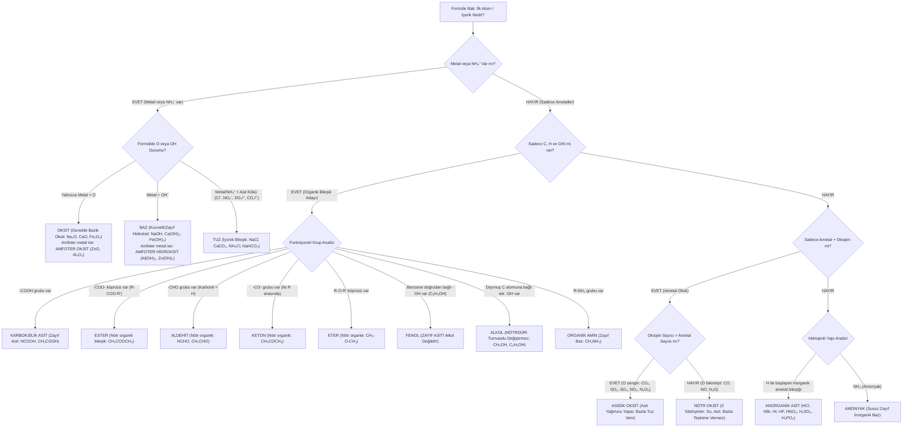

# TYT ve AYT Kimya: Bileşik Sınıflandırma ve Asit-Baz Kuvveti Rehberi
**ÖSYM Sınav Standartlarına Uygun 3 Saniyede Teşhis Algoritması, Kuvvet Kuralları ve Çeldirici Analizi**

---

## 1. Hızlı Teşhis Algoritması (Bileşik Formülü Görünce 3 Saniyede İzlenecek Yol)

Bir öğrencinin sınav anında paniklemeden ve binlerce formülü ezberlemek zorunda kalmadan karşılaştığı kimyasal türü doğru tespit edebilmesi için **4 Kademeli Evrensel Filtreleme Sistemi** uygulanır.



---

### Evrensel 4 Adımlı Hızlı Karar Kuralı (3 Saniye Filtresi)

1. **Gözün İlk Arayacağı Şey: METAL veya $NH_4^+$ (Amonyum) Katyonu**
   - Metal görüyorsan bileşik **kesinlikle iyoniktir**.
   - Arkasından gelene bak:
     - Sadece oksijen varsa $\rightarrow$ **Metal Oksit** (Bazik Oksit: $Na_2O, CaO$; veya Amfoter Oksit: $ZnO, Al_2O_3$).
     - $-OH$ varsa $\rightarrow$ **Baz** ($NaOH, Ca(OH)_2$; Amfoter Baz: $Al(OH)_3$).
     - Halojen veya anyon kökü ($Cl^-, SO_4^{2-}, NO_3^-, CO_3^{2-}, PO_4^{3-}$) varsa $\rightarrow$ **Tuz** ($NaCl, CaCO_3, KNO_3$).
     - *İstisna:* Metal olmasa bile $NH_4^+$ ile başlayan her bileşik bir **Tuzdur** ($NH_4Cl, NH_4NO_3$).

2. **C, H ve O Ailesi (Organik Karışıklığı Çözme)**
   - $-COOH$ görüyorsan $\rightarrow$ **Karboksilik Asit** ($CH_3COOH, HCOOH$). Suda $H^+$ verir.
   - $-COO-$ görüyorsan $\rightarrow$ **Ester** ($CH_3COOCH_3$). Nötrdür.
   - Karbonil ($C=O$) ucunda hidrojen varsa $\rightarrow$ **Aldehit** ($CH_3CHO$). Nötrdür.
   - Karbonil iki karbon arasındaysa $\rightarrow$ **Keton** ($CH_3COCH_3$). Nötrdür.
   - $R-O-R'$ görüyorsan $\rightarrow$ **Eter** ($C_2H_5OC_2H_5$). Nötrdür.
   - $-OH$ görüyorsan dur ve incele:
     - Benzen halkasına ($C_6H_5-$) bağlıysa $\rightarrow$ **FENOL (Zayıf Asit!)**.
     - Doymuş alifatik karbona ($R-$) bağlıysa $\rightarrow$ **ALKOL (Nötr!)**. Asla baz değildir!

3. **İki Elementli Ametal-Oksijen Yapıları (Oksitler)**
   - Formül sadece $X_nO_m$ (Ametal + Oksijen) biçimindeyse:
     - $m > n$ (Oksijence zengin: $CO_2, SO_2, SO_3, NO_2, N_2O_5$) $\rightarrow$ **Asidik Oksit**.
     - $m \le n$ (Oksijence fakir/eşit: Sadece 3 tanedir $\rightarrow CO, NO, N_2O$) $\rightarrow$ **Nötr Oksit**.

4. **Kalan Hidrojenli Moleküller**
   - Başında $H$ olup metal içermeyenler $\rightarrow$ **Asit** ($HCl, H_2SO_4, HNO_3, H_3PO_4, HF, HCN$).
   - $NH_3$ $\rightarrow$ **Zayıf Baz** (Yapısında $OH$ olmayan klasik ÖSYM tuzağı).

---

## 2. Asitlik ve Bazlık Kuvveti Kıyaslama Kuralları

> [!IMPORTANT]
> **Kuvvet Kavramı $\ne$ Derişim $\ne$ pH!**
> - **Kuvvet:** Bir asit veya bazın suda **%100 iyonlaşma** derecesidir. Kuvvetli asitler tek yönlü okla ($\rightarrow$), zayıf asitler denge okuyla ($\rightleftharpoons$) gösterilir.
> - $0.001\text{ M } HCl$ (Kuvvetli) çözeltisinin $pH = 3$'tür. $1\text{ M } HF$ (Zayıf) çözeltisinin $pH \approx 1.85$'tir. Burada $HF$ çözeltisi daha düşük pH'a ve daha yüksek $H^+$ derişimine sahip olsa da **$HCl$ katbekat daha KUVVETLİ bir asittir**. Çünkü kuvvet, suya atılan moleküllerin ne kadarının iyonlaştığıdır.

### 2.1. Halojen Asitleri (Hidroasitler - 7A Grubu: $HF, HCl, HBr, HI$)

Periyodik sistemde 7A grubunda yukarıdan aşağıya inildikçe:
$$F \longrightarrow Cl \longrightarrow Br \longrightarrow I$$

- **Yarıçap artar.** İyot atomunun hacmi çok büyüktür.
- $H-X$ bağ uzunluğu artar, **bağ enerjisi (sağlamlığı) azalır**.
- Su ortamında bağ ne kadar zayıfsa, $H^+$ iyonunun kopup suya hidronyum ($H_3O^+$) olarak verilmesi o kadar kolaylaşır.
- **Asitlik Kuvveti Sıralaması:**
  $$\mathbf{HI > HBr > HCl \gg HF}$$

| Halojen Asidi | Kuvvet Derecesi | İyonlaşma Türü | Önemli Sınav Notu |
|---|---|---|---|
| **$HI$** (Hidroiyodik asit) | Çok Kuvvetli | Suda %100 ($\rightarrow$) | Halojen asitlerinin en kuvvetlisidir. |
| **$HBr$** (Hidrobromik asit) | Kuvvetli | Suda %100 ($\rightarrow$) | Kuvvetli mineral asittir. |
| **$HCl$** (Hidroklorik asit) | Kuvvetli | Suda %100 ($\rightarrow$) | "Tuz ruhu", mide asidi; pas giderici. |
| **$HF$** (Hidroflorik asit) | **ZAYIF ASİT** | Suda Kısmi Denge ($\rightleftharpoons$) | **CAM VE PORSELENİ ÇÖZEN TEK ASİT!** |

> [!WARNING]
> **HF Neden Zayıftır ve Neden Camı Çözer?**
> 1. **Neden zayıf?** Flor atomu periyodik tablonun en elektronegatif atomudur ve çapı küçüktür. $H-F$ arasındaki bağ çok kuvvetlidir; ayrıca $HF$ molekülleri su molekülleriyle çok güçlü hidrojen bağları kurarak $H^+$ iyonunun serbest kalmasını zorlaştırır. Bu nedenle suda %1-2 mertebesinde iyonlaşır.
> 2. **Camı eritme reaksiyonu:** Cam ve porselenin ana yapısı silisyum dioksittir ($SiO_2$). $HF$, camla ekzotermik ve istemli bir kompleksleşme tepkimesi verir:
>    $$SiO_2(k) + 4HF(suda) \longrightarrow SiF_4(g) + 2H_2O(s)$$
>    *(Derişik ortamda $H_2SiF_6$ oluşur).*
>    Bu sebeple $HF$ asla cam veya porselen kapta saklanamaz; **plastik (polietilen) veya teflon** kaplarda muhafaza edilir.

---

### 2.2. Oksiasitlerde Kuvvet Kıyaslaması ($H_aXO_b$)

Oksijen atomu taşıyan inorganik asitlerde iki temel kural geçerlidir:

#### Kural A: Aynı Ametalin Farklı Sayıda Oksijen İçeren Asitleri
Merkez atom aynı, oksijen sayısı farklı ise:
- Oksijen sayısı arttıkça merkez atomun **yükseltgenme basamağı artar**.
- Son derece elektronegatif olan oksijen atomları, merkez atomdan ve $O-H$ bağından elektron yoğunluğunu kendine doğru çeker.
- $O-H$ bağı aşırı polarlaşır, zayıflar ve $H^+$ iyonunun ortama salınması son derece kolaylaşır.
- **Asitlik Kuvveti Sıralaması:**
  $$\mathbf{HClO_4 > HClO_3 > HClO_2 > HClO}$$
  - $HClO_4$ (Perklorik asit): Süper asit düzeyinde çok kuvvetli asit ($Cl^{+7}$).
  - $HClO_3$ (Klorik asit): Kuvvetli asit ($Cl^{+5}$).
  - $HClO_2$ (Kloröz asit): Orta/Zayıf asit ($Cl^{+3}$).
  - $HClO$ (Hipokloröz asit): Çamaşır suyunun etkin formu, çok zayıf asit ($Cl^{+1}$).

> [!TIP]
> **Hafıza Formülü:** Oksiasitlerde $O$ sayısı ile $H$ sayısı arasındaki fark $(b - a)$ arttıkça asitlik fırlar!
> - $(b - a) \ge 2 \rightarrow$ Kuvvetli asit ($HClO_4: 4-1=3$; $H_2SO_4: 4-2=2$; $HNO_3: 3-1=2$).
> - $(b - a) < 2 \rightarrow$ Zayıf asit ($HClO: 1-1=0$; $HNO_2: 2-1=1$; $H_3PO_4: 4-3=1$).

#### Kural B: Farklı Ametallerin Aynı Sayıda Oksijen İçeren Asitleri (Aynı Grupta)
Formülleri benzer, oksijen sayıları eşit fakat merkez atomları farklıysa ($HClO_3, HBrO_3, HIO_3$ veya $HClO, HBrO, HIO$):
- Merkez atomun **elektronegatifliği arttıkça** (7A'da yukarı çıkıldıkça: $Cl > Br > I$) elektron çekme gücü artar.
- Merkez atom elektronları çektikçe $O-H$ bağı zayıflar ve $H^+$ iyonlaşması artar.
- **Asitlik Kuvveti Sıralaması:**
  $$\mathbf{HClO > HBrO > HIO} \quad \text{veya} \quad \mathbf{HClO_4 > HBrO_4 > HIO_4}$$

---

### 2.3. Organik Karboksilik Asitlerde Kuvvet Kıyası ($R-COOH$)

Tüm karboksilik asitler zayıf asittir ($K_a \approx 10^{-4} - 10^{-5}$); suda kısmi dengeyle iyonlaşırlar:
$$R-COOH(suda) + H_2O(s) \rightleftharpoons R-COO^-(suda) + H_3O^+(suda)$$

Ancak kendi aralarındaki kuvvet kıyasında ÖSYM'nin sorguladığı iki kural vardır:

```
    H                                O
    │                                ║
H ── C ── C ── C ── ... ──► [İtiyor] ── C ── O ── H
    │                                
    H   (Alkil zinciri uzadıkça +I elektron itme artar, O-H bağı sağlamlaşır, asitlik DÜŞER!)

    Cl
    │                                O
Cl ── C ── ... ◄─── [Çekiyor] ─────── ║
    │                                C ── O ── H
    Cl  (Halojenler -I elektron çeker, O-H bağını gevşetir, asitlik ARTAR!)
```

#### 1. Alkil Zinciri Uzunluğu (Karbon Sayısı Etkisi)
- Alkil grupları ($-CH_3, -C_2H_5, -C_3H_7$) elektron salıcı (indüktif olarak elektron verici, $+I$) etki yapar.
- Karboksil grubuna bağlı karbon zinciri uzadıkça karboksil grubundaki elektron yoğunluğu artar. Bu durum $O-H$ bağını daha sıkı tutar ve $H^+$ kopmasını **zorlaştırır**.
- **Kural:** Organik asitlerde doymuş alkil zinciri uzadıkça (karbon sayısı arttıkça) **asitlik kuvveti DÜŞER**.
  $$\mathbf{HCOOH > CH_3COOH > CH_3CH_2COOH > CH_3(CH_2)_2COOH}$$
  *(En kuvvetli basit karboksilik asit Formik Asittir - Karınca Asidi).*

#### 2. Elektronegatif Atomların Bağlanması (İndüktif Etki)
- Karboksilik aside flor, klor gibi elektronegatif halojenler bağlandığında elektron çekici ($-I$) etki yaparlar.
- Bu elektron çekme etkisi, karboksilat anyonunun ($R-COO^-$) üzerindeki negatif yükü dağıtarak anyonu kararlı kılar ve $H^+$'nın ayrılmasını son derece kolaylaştırır.
- **Kural:** Halojen sayısı arttıkça ve halojen karboksil grubuna yaklaştıkça **asitlik kuvveti ARTAR**.
  $$\mathbf{CCl_3COOH > CHCl_2COOH > CH_2ClCOOH > CH_3COOH}$$
  $$\mathbf{CH_2FCOOH > CH_2ClCOOH > CH_2BrCOOH > CH_2ICOOH}$$

---

### 2.4. Bazlık Kuvveti Kıyaslama Kuralları

- **1A ve 2A Grubu Hidroksitleri:**
  - Metallerin çapı arttıkça (grupta aşağı inildikçe) elektrostatik çekim zayıflar, metal $OH^-$ iyonunu suya çok daha rahat bırakır.
  - Dolayısıyla grupta aşağı inildikçe hidroksitlerin **bazlık kuvveti ARTAR**:
    $$\mathbf{CsOH > RbOH > KOH > NaOH > LiOH}$$
    $$\mathbf{Ba(OH)_2 > Sr(OH)_2 > Ca(OH)_2 \gg Mg(OH)_2}$$
    *(1A grubu bazları, 2A grubu bazlarından daha kuvvetlidir).*
- **Geçiş Metalleri ve Diğer Hidroksitler:**
  - $Fe(OH)_2, Fe(OH)_3, Cu(OH)_2, Ni(OH)_2$ gibi geçiş metali hidroksitleri suda çok az çözünür ve **zayıf bazdır**.
  - $Al(OH)_3, Zn(OH)_2$ amfoterdir ve zayıf baz karakterlidir.
- **Amonyak ve Organik Aminler:**
  - $NH_3$ (Amonyak): Zayıf bazdır ($K_b \approx 1.8 \times 10^{-5}$).
  - $CH_3NH_2$ (Metilamin): Zayıf organik bazdır (Alkil grubunun elektron vermesiyle azottaki elektron çifti belirginleşir, $NH_3$'ten biraz daha kuvvetli bir bazdır).

---

## 3. Alkol vs Baz Ayrımı ve Fenol Analizi

### 3.1. Alkol Neden Baz Değildir?

Öğrencilerin yaptığı en büyük hata, formülde $-OH$ görünce bileşiği hemen baz ilan etmektir.

| Özellik | Gerçek Baz ($NaOH, KOH$) | Alkol ($CH_3OH, C_2H_5OH$) |
|---|---|---|
| **Bağ Türü** | İyonik ($Na^+$ ve $OH^-$ iyonları) | Kovalent ($C-O$ ve $O-H$ kovalent bağları) |
| **Suda Çözünme** | İyonlaşarak çözünür ($Na^+_{(aq)} + OH^-_{(aq)}$) | Moleküler çözünür ($C_2H_5OH_{(s)} \rightarrow C_2H_5OH_{(aq)}$) |
| **Elektrik İletkenliği**| Elektrolittir (İletir) | Elektrolit değildir (İletmez) |
| **Turnusol / pH** | Turnusolu maviye çevirir ($pH > 7$) | **Turnusola etki etmez, NÖTRDÜR ($pH = 7$)** |
| **Asitle Tepkime** | Nötralleşme tepkimesi verir, tuz + su yapar | Nötralleşme vermez (Karboksilik asitle esterleşir) |

> [!CAUTION]
> **Alkol Olma Şartları (MEB AYT Kuralı):**
> 1. $-OH$ grubunun bağlı olduğu karbon atomu doymuş ($sp^3$) olmalıdır (Çift bağlı karbona bağlıysa **enol** olur, alkol değildir).
> 2. Bir karbon atomuna birden fazla $-OH$ bağlanamaz (Kararsızdır, su kaybeder).
> 3. $-OH$ grubu doğrudan benzen halkasına bağlı olmamalıdır!

---

### 3.2. Fenol ($C_6H_5OH$) Asit midir, Baz mıdır, Alkol müdür?

```
         OH
       /    \
      |  ◎   |   ───► Fenol (C₆H₅OH)
       \    /
   (Benzen Halkası)
```

- **Soru 1: Fenol Alkol müdür?**
  - **HAYIR! KESİNLİKLE ALKOL DEĞİLDİR!**
  - Nedeni: $-OH$ grubu doğrudan aromatik benzen halkasındaki $sp^2$ hibritli karbon atomuna bağlıdır.
- **Soru 2: Fenol Asidik midir, Bazik midir?**
  - **ZAYIF ASİTTİR!** ($K_a \approx 10^{-10}$).
  - Geleneksel adı **Karbolik Asit**tir.
- **Soru 3: Fenol Neden Asidiktir?**
  - Fenol yapısından bir proton ($H^+$) koptuğunda geriye kalan **Fenolat iyonu ($C_6H_5O^-$)**, negatif yükünü benzen halkasının $\pi$ elektron sistemine rezonans yoluyla yayar. Bu rezonans kararlılığı $H^+$ iyonunun ayrılmasını mümkün kılar.

#### Fenolün Ayırt Edici Reaksiyonları (ÖSYM'nin En Sevdiği Ayıraç):
1. **Kuvvetli Bazlarla Tepkime Verir (Tuz Yapar):**
   $$C_6H_5OH + NaOH \longrightarrow C_6H_5ONa (\text{Sodyum Fenolat Tuzu}) + H_2O$$
   *(Alkoller $NaOH$ ile tepkime vermezken, fenol asit olduğu için verir!).*
2. **Aktif Metallerle ($Na, K$) $H_2$ Gazı Çıkarır:**
   $$C_6H_5OH + Na \longrightarrow C_6H_5ONa + \frac{1}{2}H_2(g)$$
3. **Zayıf Bazik Tuzlarla ($NaHCO_3$) Tepkime VERMEZ:**
   Fenol çok zayıf bir asit olduğu için karbonik asitten ($H_2CO_3$) daha zayıftır; $NaHCO_3$'tan $CO_2$ gazı çıkaramaz. (Bu özellik onu karboksilik asitlerden ayırır!).

---

## 4. Tuz Çeşitleri ve Hidroliz Kuralları

Tuzlar, asit ve bazların nötralleşme tepkimeleri sonucu oluşan iyonik bileşiklerdir. Ancak **her tuzun sulu çözeltisi nötr değildir!**

### 4.1. Altın Kural: "Kuvvetlinin Borusu Öter, Zayıfın İyonu Hidroliz Olur!"

Tuzun karakterini (asidik, bazik, nötr) daima **KUVVETLİ OLAN EBEVEYN** belirler.
Ancak su ile tepkimeye girip hidroliz olan (suyu parçalayan) daima **ZAYIF EBEVEYNDEN GELEN İYONDUR!**

```
┌──────────────────────────────┬───────────────────────────────┬───────────────────────────────┐
│ Ebeveynler                   │ Oluşan Tuzun Türü ve pH'ı     │ Hidroliz Olayı                │
├──────────────────────────────┼───────────────────────────────┼───────────────────────────────┤
│ Kuvvetli Asit + Kuvvetli Baz │ NÖTR TUZ (pH = 7)             │ HİDROLİZ OLMAZ!               │
│ (HCl + NaOH)                 │ (NaCl, KNO₃, Na₂SO₄, BaCl₂)   │ (İki iyon da pasiftir)        │
├──────────────────────────────┼───────────────────────────────┼───────────────────────────────┤
│ Kuvvetli Asit + Zayıf Baz    │ ASİDİK TUZ (pH < 7)           │ KATYON HİDROLİZ OLUR!         │
│ (HCl + NH₃)                  │ (NH₄Cl, NH₄NO₃, FeCl₃, AlCl₃) │ (NH₄⁺ + H₂O ⇌ NH₃ + H₃O⁺)     │
├──────────────────────────────┼───────────────────────────────┼───────────────────────────────┤
│ Zayıf Asit + Kuvvetli Baz    │ BAZİK TUZ (pH > 7)            │ ANYON HİDROLİZ OLUR!          │
│ (CH₃COOH + NaOH)             │ (CH₃COONa, NaHCO₃, Na₂CO₃, KF)│ (CH₃COO⁻ + H₂O ⇌ CH₃COOH + OH⁻│
├──────────────────────────────┼───────────────────────────────┼───────────────────────────────┤
│ Zayıf Asit + Zayıf Baz       │ Ka > Kb ise Asidik (pH < 7)   │ HEM ANYON HEM KATYON          │
│ (HCN + NH₃)                  │ Kb > Ka ise Bazik (pH > 7)    │ HİDROLİZ OLUR!                │
└──────────────────────────────┴───────────────────────────────┴───────────────────────────────┘
```

### 4.2. Hidroliz Tepkimelerinin Mekanizması

1. **Nötr Tuz Neden Hidroliz Olmaz?**
   - $NaCl \rightarrow Na^+ + Cl^-$
   - $Na^+$ kuvvetli baz olan $NaOH$'ın konjuge asididir; suya karşı ilgisizdir.
   - $Cl^-$ kuvvetli asit olan $HCl$'nin konjuge bazıdır; aşırı zayıftır, suyla tepkimeye giremez.
   - Sonuç: Çözeltide $H_3O^+$ veya $OH^-$ üretilmez, $pH = 7$ kalır.

2. **Asidik Tuz Neden Asidiktir?**
   - $NH_4Cl$ çözeltisinde: $NH_4Cl \rightarrow NH_4^+ + Cl^-$
   - $NH_4^+$ zayıf baz olan $NH_3$'ün kuvvetli eşlenik asididir. Su molekülünden elektron alıp proton fırlatır:
     $$NH_4^+ + H_2O \rightleftharpoons NH_3 + H_3O^+$$
   - Ortamda $H_3O^+$ (hidronyum) arttığı için çözelti **asidiktir ($pH < 7$)**.

3. **Bazik Tuz Neden Baziktir?**
   - $CH_3COONa$ veya $KF$ çözeltisinde: $KF \rightarrow K^+ + F^-$
   - $F^-$ zayıf asit olan $HF$'nin eşlenik bazıdır. Sudan proton koparır:
     $$F^- + H_2O \rightleftharpoons HF + OH^-$$
   - Ortamda $OH^-$ arttığı için çözelti **baziktir ($pH > 7$)**.

---

## 5. Popüler Öğretmen Anlatımları, Hafıza Kodları ve ÖSYM Tuzakları

### 5.1. Efsanevi Hafıza Kodları (Mnemonics)

1. **Amfoter Metaller (Hem Asitle Hem Kuvvetli Bazla Tepkime Verip $H_2$ Çıkaranlar):**
   > **"Sana Aldığım Beyaz Pabucu Çorabında Kırdım"** $\rightarrow \mathbf{Sn, Al, Be, Pb, Cr, Zn}$  
   > *(Veya: "Zengin Pablo Cariye Alıp Beyaz Sandık verdi" $\rightarrow Zn, Pb, Cr, Al, Be, Sn$)*

2. **Soy Metaller:**
   > - **Yarı Soy Metaller (Sadece kuvvetli oksiasitlerle $NO, NO_2, SO_2$ verir, asla $H_2$ veremez):**  
   >   **"Cumhur Haksızca Ağlayanların..."** $\rightarrow \mathbf{Cu, Hg, Ag}$  
   > - **Tam Soy Metaller (Tek başına hiçbir asitle tepkime vermez, sadece Kral Suyu ile çözünür):**  
   >   **"...Avucunu Patlatır"** $\rightarrow \mathbf{Au, Pt}$

3. **Nötr Oksitlerin Üç Silahşörleri:**
   > **"Can O, Ne O, N2 O"** $\rightarrow \mathbf{CO, NO, N_2O}$  
   > - Bunlar ametalce zengin veya eşit, oksijence fakirdir.
   > - Kibirli üçlüdür: **Suyla tepkime vermez, asitle tepkime vermez, bazla tepkime vermez!** Tek numaraları **YANMAKTIR** ($CO + \frac{1}{2}O_2 \rightarrow CO_2$).

4. **İndikatör Renk Değişimi:**
   > **"Asit Kızartır, Baz Morartır (Mavileştirir)"**  
   > - Turnusol kağıdı asitte kırmızı, bazda mavidir.
   > - Fenolftalein asitte renksiz, bazda **fuşya/pembe**dir.

---

### 5.2. ÖSYM Çeldiricileri ve "Düşme!" Uyarıları

> [!CAUTION]
> ### 1. TUZAK: "Formülünde -OH Olan Her Şey Bazdır" Tuzağı
> - $NaOH, KOH, Ca(OH)_2 \longrightarrow$ **BAZ** (İyonik, suda $OH^-$ verir).
> - $CH_3OH, C_2H_5OH \longrightarrow$ **ALKOL (NÖTR)** (Kovalent, turnusolu etkilemez!).
> - $CH_3COOH, HCOOH \longrightarrow$ **KARBOKSİLİK ASİT** (Suda $H^+$ verir!).
> - $C_6H_5OH \longrightarrow$ **FENOL (ZAYIF ASİT)** (Alkol DEĞİLDİR, $NaOH$ ile tepkime verir!).

> [!CAUTION]
> ### 2. TUZAK: "Her Asit-Baz Tepkimesi Nötralleşmedir" Tuzağı
> - Nötralleşme olabilmesi için **SU ($H_2O$) OLUŞMASI ZORUNLUDUR!**
> - $HCl(g) + NH_3(g) \longrightarrow NH_4Cl(k)$ tepkimesi bir asit-baz tepkimesidir **AMA NÖTRALLEŞME TEPKİMESİ DEĞİLDİR!** (Su çıkmamıştır).
> - $HCl(suda) + NH_3(suda) \longrightarrow NH_4Cl(suda)$ tepkimesi ise ortam sulu olduğu ve hidronyum ile hidroksit tepkimesi gerçekleştiği için MEB tarafından nötralleşme kabul edilir. Gaz fazındaki tepkimeye dikkat!

> [!CAUTION]
> ### 3. TUZAK: "Yemek Sodası ($NaHCO_3$) ve Kireç Taşı ($CaCO_3$) Bazdır" Tuzağı
> - $NaHCO_3$ ve $CaCO_3$ birer **TUZDUR!**
> - Evet, sulu çözeltileri bazik özellik gösterir (çünkü zayıf asit $H_2CO_3$ ile kuvvetli bazlar $NaOH, Ca(OH)_2$'in tuzlarıdır). Fakat tür sorulduğunda "baz" değil, **"Bazik Tuz"** denilmelidir.
> - Asit damlatıldığında köpürerek **$CO_2$ gazı** çıkarırlar (Asla $H_2$ değil!).

> [!CAUTION]
> ### 4. TUZAK: "HF Zayıf Asittir, Tehlikesizdir" Tuzağı
> - Kuvvet, tahribat demek değildir!
> - $HF$ zayıf asit olmasına rağmen insan derisine temas ettiğinde sinirleri uyuşturduğu için acı hissettirmeden kemiğe kadar işler, kandaki kalsiyumu bağlar ($CaF_2$) ve kalbi durdurabilir.
> - Camı ve porseleni eriten tek asittir; cam kapta saklanamaz.

> [!CAUTION]
> ### 5. TUZAK: "Organik Bileşiklerde Karbon Sayısı Arttıkça Asitlik Artar" Yanılgısı
> - Tam tersi! Karbon zinciri uzadıkça elektron itici indüktif etki büyür, $O-H$ bağı sağlamlaşır ve asitlik **AZALIR**.
> - $HCOOH > CH_3COOH > C_2H_5COOH$.

---

## 6. Örnek Bileşik Kartları (Sınav Odaklı Referans Matrisi)

| # | Formül | Bileşik Adı / Yaygın Adı | Sınıfı / Türü | Suda Çözünme / İyonlaşma Denklemi | Karakteri & Turnusol | Kritik Sınav Notu |
|---|---|---|---|---|---|---|
| **1** | $\mathbf{HCl}$ | Tuz ruhu / Hidroklorik asit | İnorganik Kuvvetli Asit | $HCl \rightarrow H^+ + Cl^-$ (%100) | Asidik (Kırmızı) | Mide asididir. Pas söker. Yarı soy metallere ($Cu, Ag$) etki etmez! |
| **2** | $\mathbf{HF}$ | Cam asidi / Hidroflorik asit | İnorganik Zayıf Asit | $HF \rightleftharpoons H^+ + F^-$ (Denge) | Asidik (Kırmızı) | Camı ve porseleni çözen tek asit! Plastik kapta saklanır. |
| **3** | $\mathbf{HNO_3}$ | Kezzap / Nitrik asit | İnorganik Kuvvetli Oksiasit | $HNO_3 \rightarrow H^+ + NO_3^-$ (%100) | Asidik (Kırmızı) | Oksitleyici asit. $Cu$ ile derişikken $NO_2$, seyreltikken $NO$ gazı çıkarır. |
| **4** | $\mathbf{H_2SO_4}$ | Zaç yağı / Sülfürik asit | İnorganik Kuvvetli Oksiasit | $H_2SO_4 \rightarrow 2H^+ + SO_4^{2-}$ (%100) | Asidik (Kırmızı) | Nem çekicidir (dehidratör). Şekeri kömürleştirir. $Cu$ ile sıcak/derişik $SO_2$ verir. |
| **5** | $\mathbf{H_3PO_4}$ | Fosforik asit | İnorganik Orta/Zayıf Asit | $H_3PO_4 \rightleftharpoons 3H^+ + PO_4^{3-}$ (Denge) | Asidik (Kırmızı) | Üç protonlu (üç değerlikli) asittir. Kola ve gübre sanayisinde kullanılır. |
| **6** | $\mathbf{HCN}$ | Hidrosiyanik asit | İnorganik Zayıf Asit | $HCN \rightleftharpoons H^+ + CN^-$ (Denge) | Zayıf Asit (Kırmızı) | Aşırı zehirlidir. Eşlenik bazı $CN^-$ hidroliz olarak ortamı bazik yapar. |
| **7** | $\mathbf{HCOOH}$ | Karınca asidi / Metanoik asit | Karboksilik Asit | $HCOOH \rightleftharpoons HCOO^- + H^+$ | Zayıf Asit (Kırmızı) | En kuvvetli basit karboksilik asittir. Hem aldehit hem asit grubu taşır (Fehling/Tollens indirger!). |
| **8** | $\mathbf{CH_3COOH}$ | Sirke asidi / Etanoik asit | Karboksilik Asit | $CH_3COOH \rightleftharpoons CH_3COO^- + H^+$ | Zayıf Asit (Kırmızı) | Kireç çözücü olarak kullanılır. Karbonatlı tuzlarla $CO_2$ gazı çıkarır. |
| **9** | $\mathbf{C_6H_5OH}$ | Fenol / Karbolik asit | Zayıf Asit (Aromatik) | $C_6H_5OH \rightleftharpoons C_6H_5O^- + H^+$ | Zayıf Asit (Kırmızı) | **ALKOL DEĞİLDİR!** $NaOH$ ile tepkime verir ama $NaHCO_3$ ile gaz çıkaramaz. |
| **10** | $\mathbf{NaOH}$ | Sudkostik / Sodyum hidroksit | Kuvvetli Baz | $NaOH \rightarrow Na^+ + OH^-$ (%100) | Bazik (Mavi) | Beyaz sabun yapımı, lavabo açıcı. Ciltte kayganlık hissi oluşturur. |
| **11** | $\mathbf{KOH}$ | Potaskostik / Potasyum hidroksit| Kuvvetli Baz | $KOH \rightarrow K^+ + OH^-$ (%100) | Bazik (Mavi) | Arap sabunu (sıvı/yumuşak sabun) yapımında ve pillerde kullanılır. |
| **12** | $\mathbf{Ca(OH)_2}$ | Sönmüş kireç / Kalsiyum hidroksit| Kuvvetli İki Değerlikli Baz | $Ca(OH)_2 \rightarrow Ca^{2+} + 2OH^-$ | Bazik (Mavi) | Kireç suyu. $CO_2$ gazı geçirildiğinde $CaCO_3$ çökeleği oluşturarak bulanır! |
| **13** | $\mathbf{NH_3}$ | Amonyak | Zayıf İnorganik Baz | $NH_3 + H_2O \rightleftharpoons NH_4^+ + OH^-$ | Bazik (Mavi) | Susuz bazdır. Asitlerle gaz fazında su çıkarmadan tuz verir. Amfoter metallerle tepkime vermez! |
| **14** | $\mathbf{CH_3OH}$ | Metanol / Odun ruhu | Alkol (Primer Alkol) | $CH_3OH(s) \rightarrow CH_3OH(suda)$ | **NÖTR (Etkisiz)** | **BAZ DEĞİLDİR!** Turnusolu değiştirmez. İletken değildir. Zehirlidir (kör eder). |
| **15** | $\mathbf{C_2H_5OH}$ | Etanol / İspirto | Alkol (Primer Alkol) | $C_2H_5OH(s) \rightarrow C_2H_5OH(suda)$ | **NÖTR (Etkisiz)** | **BAZ DEĞİLDİR!** Kolonya ve tıbbi dezenfektan. $Na$ ile $H_2$ gazı verir, $NaOH$ ile vermez! |
| **16** | $\mathbf{CH_3OCH_3}$ | Dimetil eter | Eter | Moleküler çözünür | **NÖTR (Etkisiz)** | Etanol ile fonksiyonel grup izomeridir. Dipol-dipol etkileşimi yapar, H-bağı yapamaz. |
| **17** | $\mathbf{CH_3CHO}$ | Asetaldehit / Etanal | Aldehit | Moleküler çözünür | **NÖTR (Etkisiz)** | Karbonil grubu içerir. Tollens ve Fehling ile gümüş aynası / kırmızı çökelek verir. |
| **18** | $\mathbf{CH_3COCH_3}$| Aseton / Propanon | Keton | Moleküler çözünür | **NÖTR (Etkisiz)** | En küçük ketondur (3 karbonlu). Oje çıkarıcı çözücü. Tollens'e etki etmez. |
| **19** | $\mathbf{CH_3COOCH_3}$| Metil asetat | Ester | Moleküler çözünür | **NÖTR (Etkisiz)** | Sirke kokusu değil, hoş meyve kokusu taşır. Asit ve alkolün kondenzasyon ürünüdür. |
| **20** | $\mathbf{CO_2}$ | Karbondioksit | Asidik Oksit | $CO_2 + H_2O \rightleftharpoons H_2CO_3 \rightleftharpoons H^+ + HCO_3^-$| Asidik (Kırmızı) | Ametalce zengin oksit. Suyla asit yapar. Bazlarla tuz verir. Yangın söndürücü gazdır. |
| **21** | $\mathbf{CO}$ | Karbonmonoksit | Nötr Oksit | Çözünmez / Asit-Baz tepkimesi yok | **NÖTR (Etkisiz)** | 3 Silahşörlerden biridir. Suyla, asitle, bazla tepkime vermez. Yanıcıdır ($CO_2$'ye dönüşür). |
| **22** | $\mathbf{CaO}$ | Sönmemiş kireç | Bazik Metal Oksit | $CaO + H_2O \rightarrow Ca(OH)_2 \rightarrow Ca^{2+} + 2OH^-$| Bazik (Mavi) | Suyla şiddetli ekzotermik tepkime verir ($Ca(OH)_2$ oluşturur). Asitlerle tuz yapar. |
| **23** | $\mathbf{ZnO}$ / $\mathbf{Al_2O_3}$ | Çinko oksit / Alümina | Amfoter Oksit | Hem asitle hem kuvvetli bazla tuz yapar| Amfoter | Hem asitlerle hem kuvvetli bazlarla tepkime verir, suya karşı ilgisizdir (çözünmez). |
| **24** | $\mathbf{NaCl}$ | Sofra tuzu / Sodyum klorür | Nötr Tuz | $NaCl \rightarrow Na^+ + Cl^-$ (%100) | **NÖTR (pH = 7)** | Kuvvetli asit ($HCl$) + Kuvvetli baz ($NaOH$). **HİDROLİZ OLMAZ!** İletkendir. |
| **25** | $\mathbf{NH_4Cl}$ | Nişadır / Amonyum klorür | Asidik Tuz | $NH_4Cl \rightarrow NH_4^+ + Cl^-$ | **ASİDİK (pH < 7)**| Kuvvetli asit ($HCl$) + Zayıf baz ($NH_3$). **$NH_4^+$ iyonu hidroliz olur!** Kuru pil üretimi. |
| **26** | $\mathbf{NaHCO_3}$ | Yemek sodası / Sodyum bikarbonat| Bazik Tuz | $NaHCO_3 \rightarrow Na^+ + HCO_3^-$ | **BAZİK (pH > 7)** | Zayıf asit ($H_2CO_3$) + Kuvvetli baz ($NaOH$). **$HCO_3^-$ hidroliz olur!** Asitle $CO_2$ verir. |
| **27** | $\mathbf{Na_2CO_3}$ | Çamaşır sodası / Sodyum karbonat | Bazik Tuz | $Na_2CO_3 \rightarrow 2Na^+ + CO_3^{2-}$ | **BAZİK (pH > 7)** | Su sertliğini giderir, yağ çözer. $CO_3^{2-}$ iyonu hidroliz olarak $OH^-$ üretir. |
| **28** | $\mathbf{CH_3COONa}$| Sodyum asetat | Bazik Tuz | $CH_3COONa \rightarrow Na^+ + CH_3COO^-$ | **BAZİK (pH > 7)** | Sıcak buz torbalarında kullanılır. Asetat anyonu ($CH_3COO^-$) hidroliz olur. |

---

## 7. Özet Karar Tablosu (Sınav Öncesi Hızlı Bakış)

```
┌───────────────────────────────────────────────────────────────────────────────────────┐
│                               SINAV ANINDA 3 SANİYELİK KONTROL                         │
├───────────────────────────────┬──────────────────────────────────┬────────────────────┤
│ Bileşik Formülü               │ İlk Düşünce                      │ Kesin Teşhis       │
├───────────────────────────────┼──────────────────────────────────┼────────────────────┤
│ CH₃OH                         │ "OH var, baz mı?" ❌             │ NÖTR ALKOL         │
│ C₆H₅OH                        │ "OH var, alkol mü?" ❌           │ ZAYIF ASİT (Fenol) │
│ CH₃COOH                       │ "OH var, alkol/baz mı?" ❌       │ KARBOKSİLİK ASİT   │
│ NH₃                           │ "OH yok, asit mi?" ❌            │ ZAYIF BAZ          │
│ CO₂                           │ "Metalsiz oksit, nötr mü?" ❌    │ ASİDİK OKSİT       │
│ CO                            │ "Ametal oksit, asit mi?" ❌      │ NÖTR OKSİT         │
│ NaHCO₃                        │ "Baz mı?" ❌                     │ BAZİK TUZ          │
│ NH₄Cl                         │ "Klor var, asit mi?" ❌          │ ASİDİK TUZ         │
│ HF                            │ "Kuvvetli mineral asit mi?" ❌   │ ZAYIF ASİT (Camı!) │
│ HI                            │ "HF'den zayıf mı?" ❌            │ EN KUVVETLİ 7A     │
└───────────────────────────────┴──────────────────────────────────┴────────────────────┘
```
